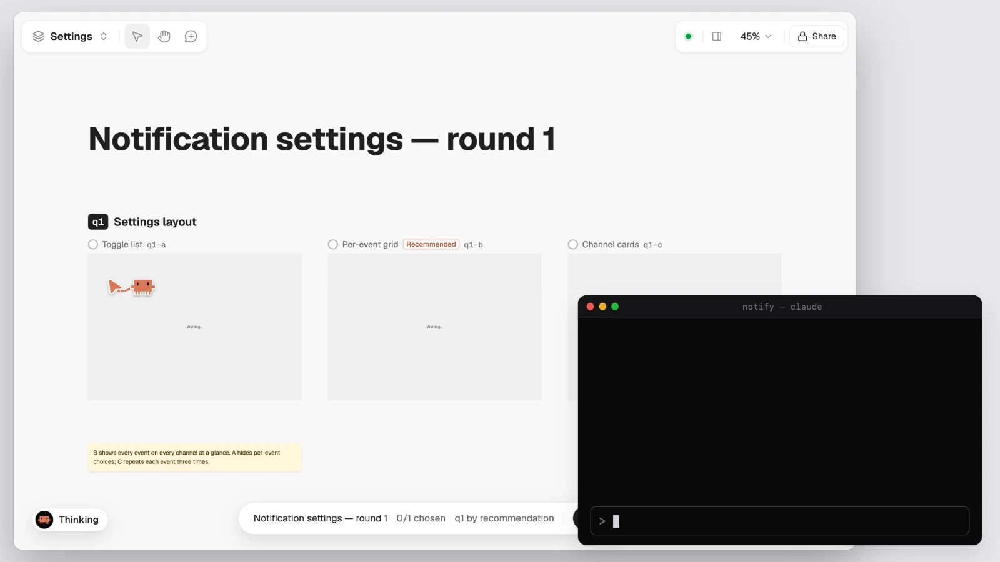
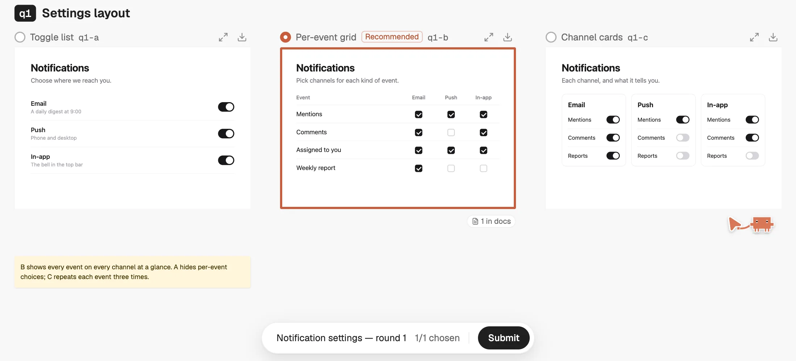
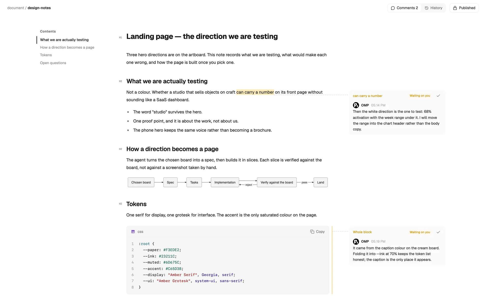
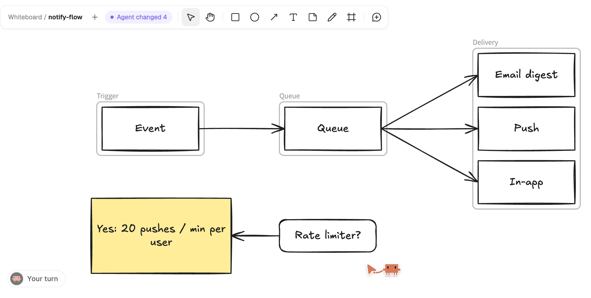
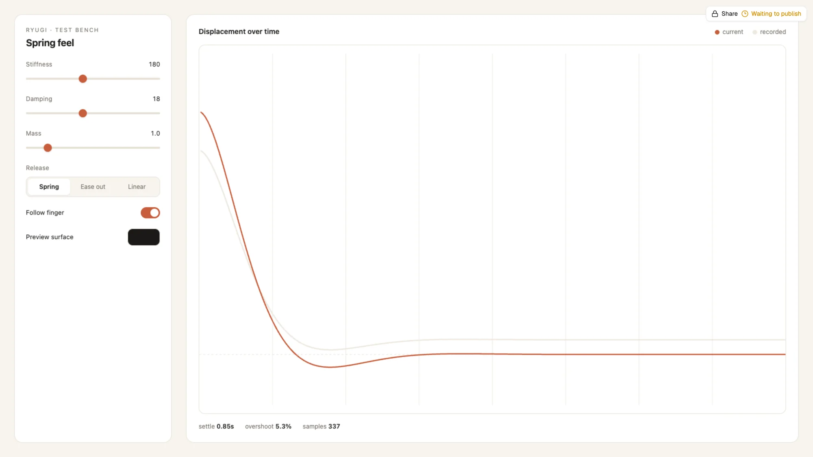
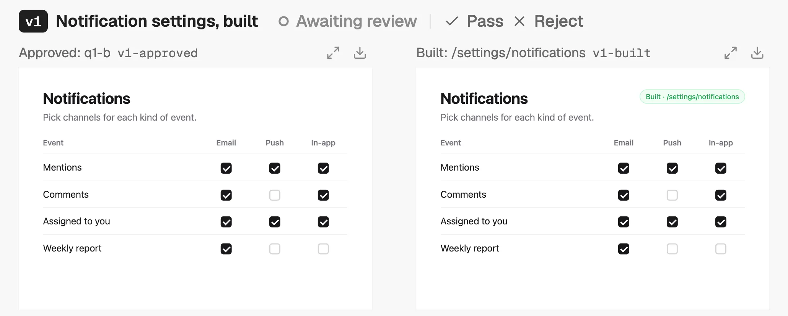
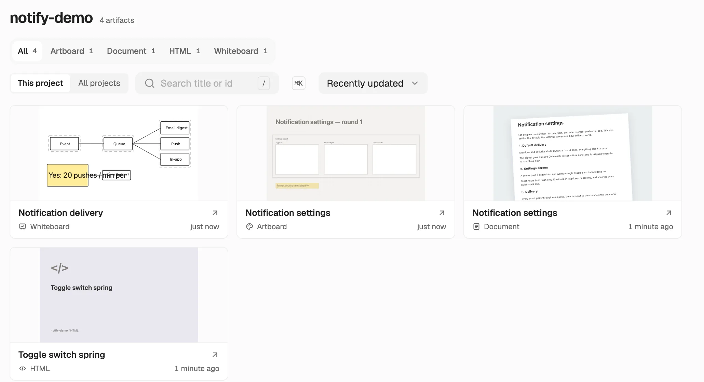
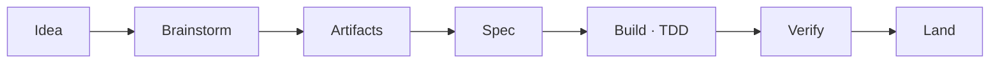

<p align="center">
  
</p>

<h1 align="center">Ryugi 流儀</h1>

<p align="center"><b>Artifacts for coding agents.</b><br>Your agent draws its options instead of describing them. You pick, comment and pass.</p>

<p align="center">
  
</p>

Ask an agent for a settings page and you get three paragraphs describing three layouts. Ask for a
design and you get a wall of Markdown you can't point at.

Ryugi gives the agent pages to put that work on, and gives you a way to answer on them:

- **Artboard** — every option drawn side by side; pick one.
- **Document** — a design doc with the agent's questions inline; comment on any sentence.
- **Whiteboard** — boxes and arrows you both draw on.
- **HTML** — one page with real sliders to tune a component or a motion.
- **Verify** — the built screen next to what you approved, and a report of what the agent proved
  by running it; pass or reject.

Your picks, comments and verdicts go straight back to the agent session that made the page. Every
artifact lives in your project, opens from one local server, and becomes a link when you want to
share it.

```bash
npx ryugi-artifacts install
```

It asks one question and installs Ryugi into Claude Code:

- **Artifacts only** — send `Show me three directions for a settings page` and an artboard opens.
- **The full workflow** — artifacts plus skills that brainstorm, spec, build under TDD and verify.
  Send `Let's make a react todo list` and the agent opens an artboard before it writes code.

<p align="center">
  <a href="docs/install.md">Harnesses</a> · <a href="docs/artifacts-cli.md">CLI</a> · <a href="docs/workflow.md">Full workflow</a> · <a href="https://ryugi.innei.dev">Ryugi Cloud</a>
</p>

## Artboard — choose instead of imagine

**Use it when** there is more than one way it could look.

<picture>
  <source media="(prefers-color-scheme: dark)" srcset="docs/images/artboard-dark.webp">
  
</picture>

The agent draws every option side by side and marks the one it recommends. Pick, comment on any
pixel, and Submit sends your answer back.

## Document — design docs you can argue with

**Use it when** the decision is structure, architecture or tradeoffs.

<picture>
  <source media="(prefers-color-scheme: dark)" srcset="docs/images/document-dark.webp">
  
</picture>

The agent asks its questions inside the doc and links the boards it drew. Comment on a sentence or
edit in place; your edits and the agent's merge live.

## Whiteboard — sketch the structure together

**Use it when** the parts and arrows are still the question.

<picture>
  <source media="(prefers-color-scheme: dark)" srcset="docs/images/whiteboard-dark.webp">
  
</picture>

You both draw on it. Select what you drew, ask about it, and the answer lands next to your sketch.

## HTML — tune it with real controls

**Use it when** one thing needs tuning: a component, a type scale, a motion.

<picture>
  <source media="(prefers-color-scheme: dark)" srcset="docs/images/html-dark.webp">
  
</picture>

A one-page bench whose sliders keep their values when the agent rewrites the page.

## Verify — you pass or reject

**Use it when** the work is built and you decide whether it matches.

<picture>
  <source media="(prefers-color-scheme: dark)" srcset="docs/images/verify-dark.webp">
  
</picture>

The built page sits next to the design you approved. Pass it, or reject it and say what is off; it
comes back fixed.

What a screen can't show goes in a **verify report**: one line per claim the agent checked by
running something — a test run, an API response, a migration count, which build is deployed — with
the raw output one click away, and a "Not verified" list of what it couldn't check and why. You read
it top to bottom and pass, reject or waive; screens still get judged on the artboard, and the
report links to them.

## Comments go back to the agent

**Use it when** you'd rather point at the thing than describe it in the terminal.

Pin a comment on a board, a sentence or a sketch, and it reaches the agent session that opened the
page. In Claude Code it arrives on its own, with no message from you; the agent applies it, replies
under your comment and updates the page while you watch. Questions, picks and verdicts travel the
same way.

## Library — every artifact, one server

**Use it when** you want last week's mockup back, or a link to share.

<picture>
  <source media="(prefers-color-scheme: dark)" srcset="docs/images/library-dark.webp">
  
</picture>

```bash
npx ryugi-artifacts
```

Local first, no subscription, no agent session needed. One server covers every project on the
machine, with ⌘K to jump and links that survive a restart. `publish` shares one to
[Ryugi Cloud](https://ryugi.innei.dev).

For a `ryugi` command in your terminal, install the CLI globally:

```bash
npm install -g ryugi-artifacts
ryugi
ryugi /path/to/project
```

`ryugi-artifacts` remains an alias. Installing the plugin alone does not add `ryugi` to your PATH;
the agent uses the plugin's launcher. The global CLI is optional and updates separately with
`ryugi update`. See the [CLI guide](docs/artifacts-cli.md) for commands and options.

## Add the full workflow

Artifacts work on their own. If you also want the agent to build from what you approved, pick the
full workflow at install (or run `npx ryugi-artifacts install --mode full` later). Its skills make
the agent reach for the artifacts at the right moment, and they fire on their own:



After you sign off, the agent slices the spec into tasks, proves each one red-green, keeps a ledger
of judgment calls across compaction, gets one fresh review of the branch, and reports how to land
it. Debugging and worktrees are covered too. [How it works →](docs/workflow.md)

## Work with your harness

Have Node.js and npm available in the agent's environment. The plugin calls its own launcher,
which downloads `ryugi-artifacts` on first use and caches each release under
`~/.cache/ryugi/artifacts/` by default. It checks for updates at most once a day and can reuse a
compatible cached release offline. The first run needs network access and a writable cache.

### Claude Code settings

Ryugi replaces Claude's hosted Artifacts with the Artboard, documents, whiteboards and HTML
benches. Turn the hosted ones off by adding this key to the top level of `~/.claude/settings.json` —
keep your other settings:

```json
{
  "disableArtifact": true
}
```

That is the only flag Ryugi needs; leave the rest of your Claude Code settings alone.

<details>
<summary>Other harnesses</summary>

| Harness       | Command                                                                                               |
| ------------- | ----------------------------------------------------------------------------------------------------- |
| Antigravity   | `agy plugin install https://github.com/Innei/ryugi`                                                   |
| Codex, Cursor | Add this repo as a local plugin source ([detail](docs/install.md#codex-cursor))                       |
| Devin CLI     | `devin plugins install Innei/ryugi`                                                                   |
| Factory Droid | `droid plugin marketplace add https://github.com/Innei/ryugi` then `droid plugin install ryugi@ryugi` |
| Gemini CLI    | `gemini extensions install https://github.com/Innei/ryugi`                                            |
| Kimi Code     | `/plugins install https://github.com/Innei/ryugi`                                                     |
| OpenCode      | [.opencode/INSTALL.md](.opencode/INSTALL.md)                                                          |
| Pi            | `pi install git:github.com/Innei/ryugi`                                                               |
| Qwen Code     | `qwen extensions install Innei/ryugi`                                                                 |
| Hermes Agent  | `hermes plugins install Innei/ryugi --enable`                                                         |
| Muse          | `muse plugins install ./` then `muse plugins approve ryugi`                                           |

Updates and caveats: [docs/install.md](docs/install.md).

</details>

## Credits

Fork of [Superpowers](https://github.com/obra/superpowers) v7.0.0 by Jesse Vincent and [Prime Radiant](https://primeradiant.com) ([UPSTREAM.md](UPSTREAM.md)). [Issues](https://github.com/Innei/ryugi/issues) and PRs welcome; [AGENTS.md](AGENTS.md) has the rules.

## License

Skills, harness integrations and docs: [Ryugi License 1.0](LICENSE) — free to
use, modify and redistribute, with two exceptions. The Restricted Parties in
Schedule A (Tencent, Alibaba, ByteDance, Baidu, Huawei, Xiaomi, Meituan, JD,
PDD, NetEase, Kuaishou, Didi, Ant Group, iFlytek, SenseTime, and products such
as WorkBuddy, Qwen, Qoder and Trae) receive no rights at all, and nobody may
scrape the skills into a marketplace. This is source-available, not an open
source license; material derived from Superpowers and contributions made before
2026-11-04 stay MIT (Exhibit B).

The artifacts application, published to npm as [`ryugi-artifacts`](https://www.npmjs.com/package/ryugi-artifacts), is proprietary (npm `license`: `UNLICENSED`) and not part of this repository. Releases up to 1.51.2 were published under AGPL-3.0-only.
