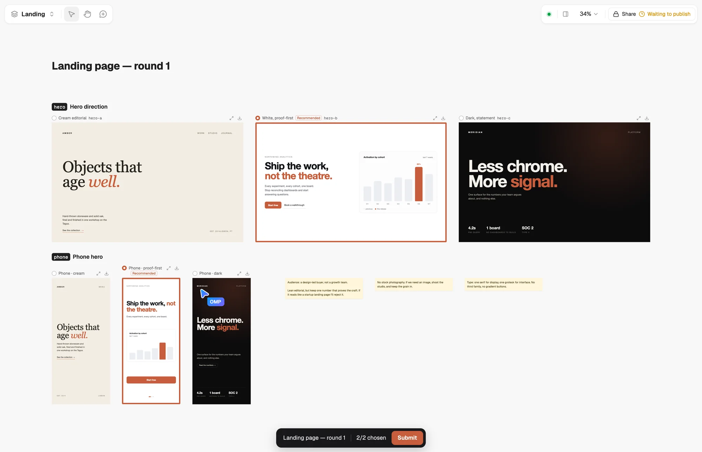
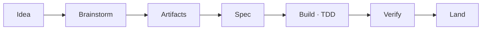

<p align="center">
  
</p>

<h1 align="center">Ryugi 流儀</h1>

<p align="center"><b>A skills collection for coding agents — and the artifacts workbench they think in.</b></p>

```text
/plugin marketplace add Innei/ryugi
/plugin install ryugi@ryugi-dev
```

Then send `Let's make a react todo list`. Ryugi starts brainstorming before any code, draws the
options instead of describing them, and builds what you approve under TDD.

<p align="center">
  <a href="docs/install.md">Harnesses</a> · <a href="docs/workflow.md">Workflow</a> · <a href="docs/artifacts-cli.md">CLI</a>
</p>

<picture>
  <source media="(prefers-color-scheme: dark)" srcset="docs/images/hero-dark.webp">
  
</picture>

**Artboard.** Every option side by side, drawn live while you watch. Two of them are chosen here;
Submit sends the round back with the brief. Comment on any pixel and answer in the terminal
(`q1 → b`).

## Two parts, one install

**Skills** — the agent's development workflow: brainstorm, spec, TDD, debug, verify, worktrees.

**Artifacts workbench** — the surface they work on: an artboard for choosing between options,
documents to comment on, live HTML pages to tune, and a library across every project. It is not
limited to mockups or to brainstorming; architecture, reviews, proposals, test benches and
verification share the same canvas. The skills use it, and `npx ryugi-artifacts` opens it without
an agent.

## How it works



Skills fire on their own; there is nothing to invoke. After you sign off, the agent slices the
spec into tasks, proves each one red-green, keeps a ledger of judgment calls across compaction,
gets one fresh review of the branch, and reports how to land it.
[How it works →](docs/workflow.md)

## Document — design docs you can argue with

<picture>
  <source media="(prefers-color-scheme: dark)" srcset="docs/images/document-dark.webp">
  
</picture>

Diagrams, charts, code, tables. A design document, a review, a proposal, a walkthrough of a flow:
comment on a sentence, edit in place; your edits and the agent's merge live.

## HTML — tune it with real controls

<picture>
  <source media="(prefers-color-scheme: dark)" srcset="docs/images/html-dark.webp">
  
</picture>

One surface, one dimension: a component, a type scale, a background, a motion. A one-page test
bench with sliders that keep their values when the agent rewrites the page.

## Verify — you pass or reject

<picture>
  <source media="(prefers-color-scheme: dark)" srcset="docs/images/verify-dark.webp">
  
</picture>

Built work next to the approved design, in the same canvas. Pass a group, or reject it and say
what is off; it comes back fixed.

## Library — one server, every project

<picture>
  <source media="(prefers-color-scheme: dark)" srcset="docs/images/library-dark.webp">
  
</picture>

```bash
npx ryugi-artifacts
```

Local first, no subscription, no agent session needed. One server serves every project on the
machine: recent work across all of them, ⌘K to jump, artifact links that survive a restart and a
new release. `publish` shares one to [Ryugi Cloud](https://ryugi.innei.dev).

## Work with your harness

<details>
<summary>Other harnesses</summary>

| Harness       | Command                                                                                               |
| ------------- | ----------------------------------------------------------------------------------------------------- |
| Antigravity   | `agy plugin install https://github.com/Innei/ryugi`                                                   |
| Codex, Cursor | Add this repo as a local plugin source ([detail](docs/install.md#codex-cursor))                       |
| Devin CLI     | `devin plugins install Innei/ryugi`                                                                   |
| Factory Droid | `droid plugin marketplace add https://github.com/Innei/ryugi` then `droid plugin install ryugi@ryugi` |
| Gemini CLI    | `gemini extensions install https://github.com/Innei/ryugi`                                            |
| Kimi Code     | `/plugins install https://github.com/Innei/ryugi`                                                     |
| OpenCode      | [.opencode/INSTALL.md](.opencode/INSTALL.md)                                                          |
| Pi            | `pi install git:github.com/Innei/ryugi`                                                               |
| Qwen Code     | `qwen extensions install Innei/ryugi`                                                                 |
| Hermes Agent  | `hermes plugins install Innei/ryugi --enable`                                                         |
| Muse          | `muse plugins install ./` then `muse plugins approve ryugi`                                           |

Updates and caveats: [docs/install.md](docs/install.md).

</details>

## Credits

Fork of [Superpowers](https://github.com/obra/superpowers) v7.0.0 by Jesse Vincent and [Prime Radiant](https://primeradiant.com) ([UPSTREAM.md](UPSTREAM.md)). [Issues](https://github.com/Innei/ryugi/issues) and PRs welcome; [AGENTS.md](AGENTS.md) has the rules.

## License

Skills, harness integrations and docs: [Ryugi License 1.0](LICENSE) — free to
use, modify and redistribute, with two exceptions. The Restricted Parties in
Schedule A (Tencent, Alibaba, ByteDance, Baidu, Huawei, Xiaomi, Meituan, JD,
PDD, NetEase, Kuaishou, Didi, Ant Group, iFlytek, SenseTime, and products such
as WorkBuddy, Qwen, Qoder and Trae) receive no rights at all, and nobody may
scrape the skills into a marketplace. This is source-available, not an open
source license; material derived from Superpowers and contributions made before
2026-11-04 stay MIT (Exhibit B).

The artifacts application, published to npm as [`ryugi-artifacts`](https://www.npmjs.com/package/ryugi-artifacts), is proprietary (npm `license`: `UNLICENSED`) and not part of this repository. Releases up to 1.51.2 were published under AGPL-3.0-only.
