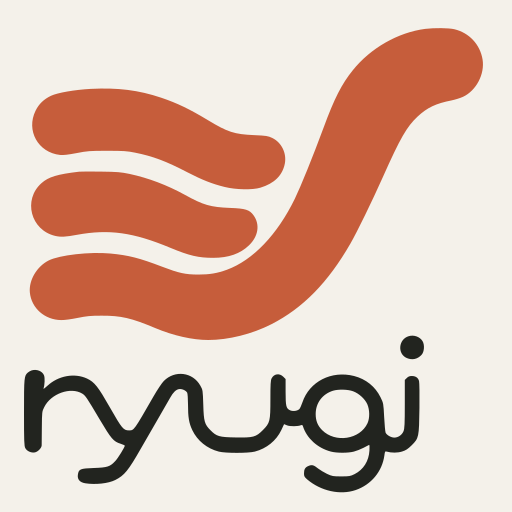
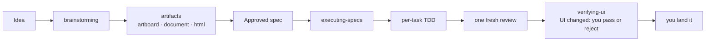

<p align="center">
  
</p>

<h1 align="center">Ryugi 流儀</h1>

<p align="center">Brainstorm with mockups. Approve a spec. Build it inline under TDD.</p>

Ryugi (りゅうぎ, "one's own way of doing things") is a software development workflow for coding agents: a few composable skills plus a bootstrap that makes sure your agent uses them. It started as a fork of [Superpowers](https://github.com/obra/superpowers) v7.0.0 and was reshaped around a single workflow.

## How it works

Your agent doesn't jump into code. It asks what you're really trying to do, pulls a spec out of the conversation, and plays it back in chunks short enough to read.

When seeing beats reading, it opens a local artifact: a document for architecture, reviews and proposals; an artboard to compare mockups across several dimensions; or one HTML page — a test bench with sliders, a focused design study — that updates live as the agent rewrites it. HTML artifacts can use a bundled Web Component kit (Lobe UI buttons, inputs, sliders, switches, cards) so a test bench looks like the product and keeps its settings across rewrites. Everything runs locally; no subscription.



After you sign off, it builds inline from the spec unless you say "just code it": your agent slices the spec into tasks, proves each with true red/green TDD, keeps a ledger of every judgment call across compaction, gets one fresh review of the whole branch, then reports how to land it — squash (default), rebase, PR, or keep. Never a merge commit.

Two-hour autonomous stretches without "should I continue?" are normal. Because the skills trigger automatically, there is nothing to invoke.

## Install

Install from this repository; Ryugi is in no harness's official marketplace. If you use several harnesses, install it in each. [docs/install.md](docs/install.md) has update commands, caveats, and per-harness detail.

| Harness | Command |
|---|---|
| Claude Code | `/plugin marketplace add Innei/ryugi` then `/plugin install ryugi@ryugi-dev` |
| Antigravity | `agy plugin install https://github.com/Innei/ryugi` |
| Codex, Cursor | Add this repo as a local plugin source ([detail](docs/install.md#codex-cursor)) |
| Devin CLI | `devin plugins install Innei/ryugi` |
| Factory Droid | `droid plugin marketplace add https://github.com/Innei/ryugi` then `droid plugin install ryugi@ryugi` |
| Gemini CLI | `gemini extensions install https://github.com/Innei/ryugi` |
| Kimi Code | `/plugins install https://github.com/Innei/ryugi` |
| OpenCode | [.opencode/INSTALL.md](.opencode/INSTALL.md) |
| Pi | `pi install git:github.com/Innei/ryugi` |
| Qwen Code | `qwen extensions install Innei/ryugi` |
| Hermes Agent | `hermes plugins install Innei/ryugi --enable` |
| Muse | `muse plugins install ./` then `muse plugins approve ryugi` |

Verify with a clean session: send `Let's make a react todo list`. A working install triggers `brainstorming` before any code is written.

## Browse project artifacts

Open a project's saved artboards, documents and HTML pages without starting an agent session:

```bash
npx ryugi-artifacts
npx ryugi-artifacts /path/to/project
npx ryugi-artifacts --no-open
```

The local library shows content previews, type filters and title/id search. Sort by newest update, oldest update or name. Previews load as their cards come into view; opening a card takes you to the full artifact. The server reads `.ryugi/artifacts/` in the selected project and keeps the library in sync with file changes.

The command reuses a running project server. A new server stays in the terminal; Ctrl+C stops it and keeps your artifacts. Node.js is required.

Browser links use a stable random ID, such as `/document/<id>` or `/artboard/<id>?page=review`. Files and CLI locators keep their readable slugs (`document/design-notes`). Each artifact stores its browser ID in `.artifact-id` inside its directory; keep that file when renaming or moving the directory within its type. Existing slug links still open and switch to the ID address. When duplicating an artifact as new work, omit `.artifact-id` from the copy so it receives its own ID; conflicting IDs are reported instead of choosing one copy.

Artboard page links restore the selected page on refresh and support browser back and forward. Page changes also carry into cloud share links.

The same CLI runs what the skill uses: `npx ryugi-artifacts start`, `stop` and `publish` (`--help` lists their options; add `--json` for one JSON line). For development, run `cd artifacts && pnpm build`, then `node artifacts/bin/ryugi-artifacts.cjs /path/to/project` from the repository root.

Cloud publish failures keep the cloud HTTP status in `publish --json` output. When provided, `code`, `plan`, and `limit` (`kind`, `used`, `max`, and `requested`) are preserved. Account quota failures remain `type: "plan-limit"` with exit code 2; artifact storage exhaustion uses `code: "artifact_storage_limit"`, status 413 and exit code 1. Auto-publish reports the same exhaustion reason immediately.

## The workflow

1. **brainstorming** — activates before building anything. Draws out what you actually want and why, then plays its understanding back for correction. Questions start in chat, one at a time; once the work spans modules or reaches the architecture, or you ask for a design up front, they move into a document you answer a round at a time. What you'll see is designed on the Artboard, a round of options at a time. Small changes get agreed in chat; projects get a design document a builder could build from.
2. **executing-specs** — activates when you approve the spec and choose inline. Slices the spec into tasks, implements each under TDD with a ledger that survives compaction, records every judgment call as a ruling, gets one fresh review, then stops and reports.
3. **test-driven-development** — activates during implementation. RED-GREEN-REFACTOR: failing test, watch it fail, minimal code, watch it pass, commit.
4. **systematic-debugging** — activates on a bug or unexpected behavior. Root cause before fixes.
5. **verifying-ui** — activates when built work or a bug fix changes what you see. Puts real screenshots and recordings next to the approved design (or before next to after) on the Artboard; you pass or reject each group in the browser, and rejected ones come back fixed until all pass.
6. **using-git-worktrees** — activates when work needs isolation. Follows your stated preference. Without one, executing-specs works in place beside other agents and opens a worktree only when the work would collide with theirs: a file with someone else's uncommitted edits, a path another agent is exploring, or a lockfile, branch switch or repo-wide change.
7. **artifacts** — activates when something is clearer to look at than to read, in brainstorming or anywhere else. Artboards, live HTML pages, and a bundled Web Component kit, each at its own local link.

**Your project's own skills come first at their step** — a design system before mockups, a verify skill before reporting, a ship skill for merging. Ryugi sets the process; your project carries its domain.

## What's inside

- **Process** — `brainstorming`, `artifacts`, `executing-specs`, `verifying-ui`
- **Discipline** — `test-driven-development`, `systematic-debugging`
- **Workspace** — `using-git-worktrees`
- **Meta** — `using-ryugi` (bootstrap, plus evidence before claims)

`writing-skills` — creating and testing skills — lives at `.claude/skills/writing-skills/` and loads only when you work on Ryugi itself.

## Credits

Ryugi is a fork of [Superpowers](https://github.com/obra/superpowers) v7.0.0 by Jesse Vincent and [Prime Radiant](https://primeradiant.com), used under the MIT License. [UPSTREAM.md](UPSTREAM.md) records the baseline and how to port upstream changes. The skill design, the TDD and debugging disciplines, and most harness integrations come from there.

Bug reports and ideas: [Issues](https://github.com/Innei/ryugi/issues). Contributions: fork, branch, follow the repo-local `writing-skills` skill, open a PR against `main` with the template filled in. Plugin infrastructure tests live in `tests/`; [docs/testing.md](docs/testing.md) lists what each suite covers.

## License

MIT — see [LICENSE](LICENSE).
