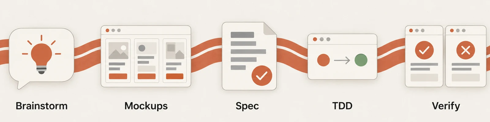
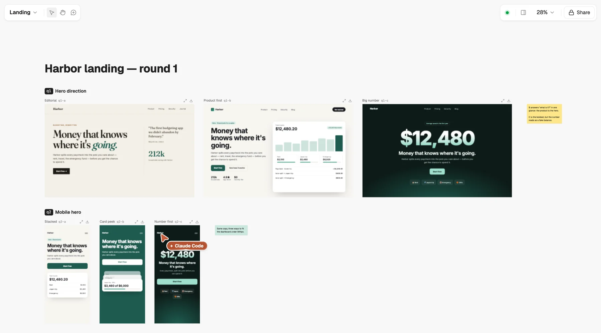
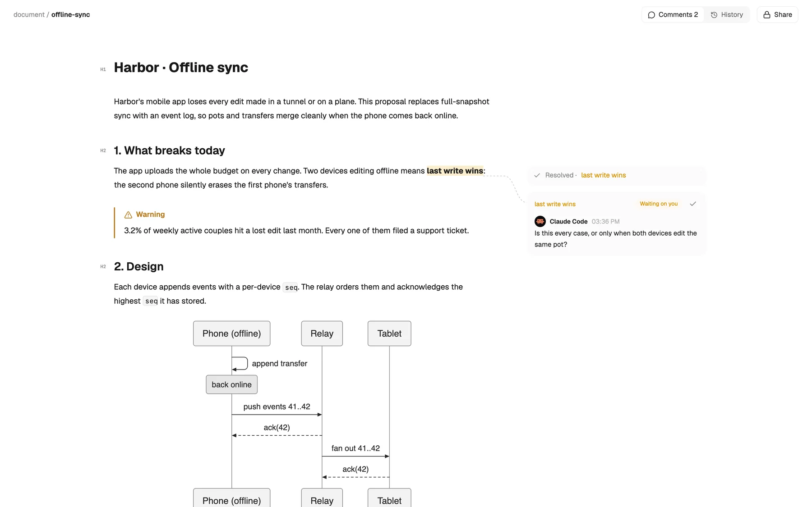
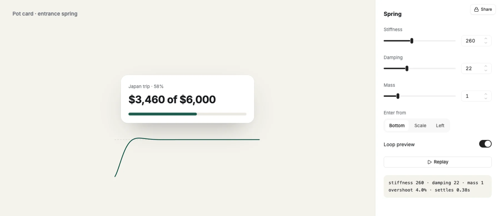
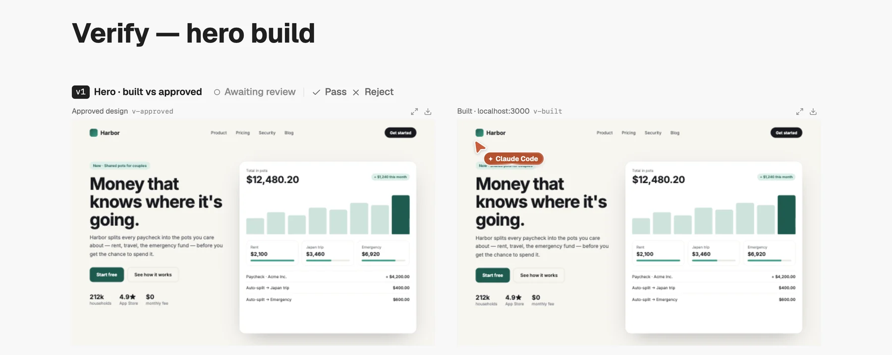
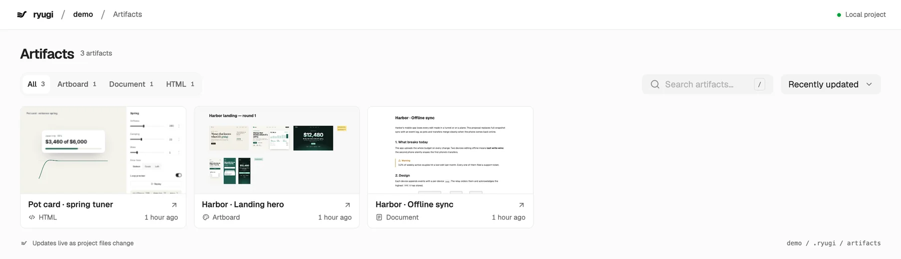

<p align="center">
  
</p>

<h1 align="center">Ryugi 流儀</h1>

<p align="center"><b>Your coding agent stops describing UI and starts showing it.</b></p>

<p align="center">
  
</p>

<p align="center">
  <a href="#install">Install</a> · <a href="docs/workflow.md">Workflow</a> · <a href="docs/artifacts-cli.md">CLI</a>
</p>



Skills fire on their own. Nothing to invoke. [How it works →](docs/workflow.md)

## Artboard: pick a direction, don't read about one



Every option side by side, drawn live while you watch. Comment on any pixel; answer in the terminal (`q1 → b`).

## Document: design docs you can argue with



Diagrams, charts, code, tables. Comment on a sentence, edit in place; your edits and the agent's merge live.

## HTML: tune it with real controls



A one-page test bench. Sliders keep their values when the agent rewrites the page.

## Verify: you pass or reject



Built screenshots next to the approved design. Reject one, and it comes back fixed.

## Library



```bash
npx ryugi-artifacts
```

Local first, no subscription. One command shares a link to [Ryugi Cloud](https://ryugi.innei.dev).

## Install

```text
/plugin marketplace add Innei/ryugi
/plugin install ryugi@ryugi-dev
```

Then send `Let's make a react todo list`. Ryugi starts brainstorming before any code.

<details>
<summary>Other harnesses</summary>

| Harness | Command |
|---|---|
| Antigravity | `agy plugin install https://github.com/Innei/ryugi` |
| Codex, Cursor | Add this repo as a local plugin source ([detail](docs/install.md#codex-cursor)) |
| Devin CLI | `devin plugins install Innei/ryugi` |
| Factory Droid | `droid plugin marketplace add https://github.com/Innei/ryugi` then `droid plugin install ryugi@ryugi` |
| Gemini CLI | `gemini extensions install https://github.com/Innei/ryugi` |
| Kimi Code | `/plugins install https://github.com/Innei/ryugi` |
| OpenCode | [.opencode/INSTALL.md](.opencode/INSTALL.md) |
| Pi | `pi install git:github.com/Innei/ryugi` |
| Qwen Code | `qwen extensions install Innei/ryugi` |
| Hermes Agent | `hermes plugins install Innei/ryugi --enable` |
| Muse | `muse plugins install ./` then `muse plugins approve ryugi` |

Updates and caveats: [docs/install.md](docs/install.md).

</details>

## Credits

Fork of [Superpowers](https://github.com/obra/superpowers) v7.0.0 by Jesse Vincent and [Prime Radiant](https://primeradiant.com) ([UPSTREAM.md](UPSTREAM.md)). MIT — see [LICENSE](LICENSE). [Issues](https://github.com/Innei/ryugi/issues) and PRs welcome; [AGENTS.md](AGENTS.md) has the rules.
