<p align="center">
  
  
</p>

<h1 align="center">Artideck — Interactive Artifacts for Coding Agents</h1>

<p align="center"><i>Formerly Ryugi (流儀)</i></p>

<p align="center"><b>Interactive artboards, design docs, whiteboards, HTML benches, slides, data reports, video storyboards and verify reports for coding agents.</b><br>Your agent draws its options instead of describing them in Markdown. Pick, comment and send feedback straight back to your agent session.</p>

<p align="center">
  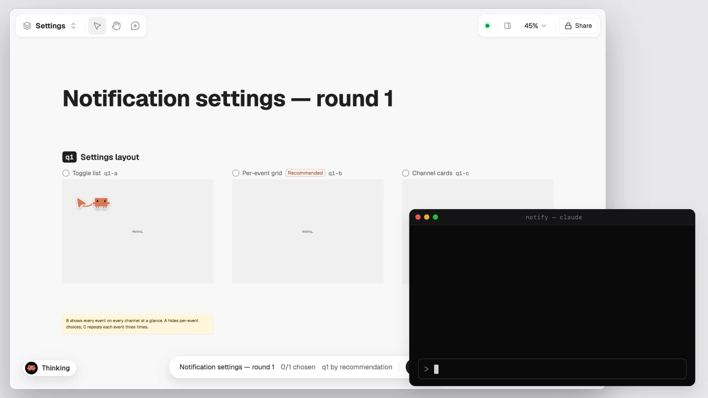
</p>

Ask an agent for a settings page and you get three paragraphs describing three layouts. Ask for a
design and you get a wall of Markdown you can't point at.

Artideck gives the agent pages to put that work on, and gives you a way to answer on them:

- **Artboard** — every option drawn side by side; pick one.
- **Document** — a design doc with the agent's questions inline; comment on any sentence.
- **Whiteboard** — boxes and arrows you both draw on.
- **HTML** — one page with real sliders to tune a component or a motion.
- **Slides** — a deck the agent writes and you present, with your notes on a second screen; fix
  any slide by hand.
- **Report** — charts and tables drawn from scripts that read your real data; refresh for new
  numbers.
- **Storyboard** — a demo video planned shot by shot with its voiceover, then cut on a multitrack
  timeline and exported.
- **Verify** — the built screen next to what you approved, and a report of what the agent proved
  by running it; pass or reject.

Your picks, comments and verdicts go straight back to the agent session that made the page. Every
artifact lives in your project, opens from one local server, and becomes a link when you want to
share it.

```bash
npx artideck install
```

Having your agent install it? Paste this so it asks before choosing for you:

```text
Install Artideck from https://github.com/Innei/artideck. Follow "Installing with an AI agent" in its README, and ask me which install I want before you run anything.
```

<p align="center"><sub>Works with Claude Code · Codex · Cursor · Gemini CLI · OpenCode · Copilot CLI · Pi · Antigravity · Kimi Code · Qwen Code · Devin · Droid</sub></p>

Free and local-first: artifacts live in your project and open from a local server, no account
needed. In Claude Code, a comment you pin reaches the agent on its own — it edits, replies under
your comment, and the page updates while you watch. Publish to Artideck Cloud only when you want a link.

The terminal wizard installs a persistent `adeck` command, lets you select one or more
harnesses, then asks which content to install:

- **Artifacts only** — send `Show me three directions for a settings page` and an artboard opens.
- **The full workflow** — artifacts plus skills that brainstorm, spec, build under TDD and verify.
  Send `Let's make a react todo list` and the agent opens an artboard before it writes code.

<p align="center">
  <a href="docs/install.md">Harnesses</a> · <a href="docs/artifacts-cli.md">CLI</a> · <a href="docs/workflow.md">Full workflow</a> · <a href="https://artideck.dev">Artideck Cloud</a>
</p>

## Artboard — choose instead of imagine

**Use it when** there is more than one way it could look.

<picture>
  <source media="(prefers-color-scheme: dark)" srcset="docs/images/artboard-dark.webp">
  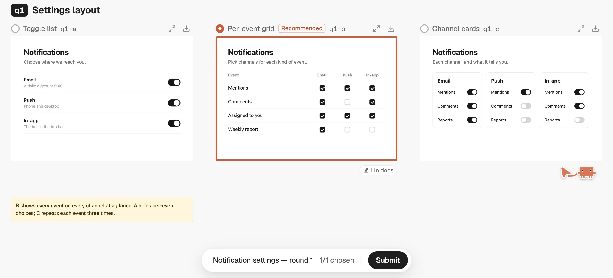
</picture>

The agent draws every option side by side and marks the one it recommends. Pick, comment on any
pixel, and Submit sends your answer back.

## Document — design docs you can argue with

**Use it when** the decision is structure, architecture or tradeoffs.

<picture>
  <source media="(prefers-color-scheme: dark)" srcset="docs/images/document-dark.webp">
  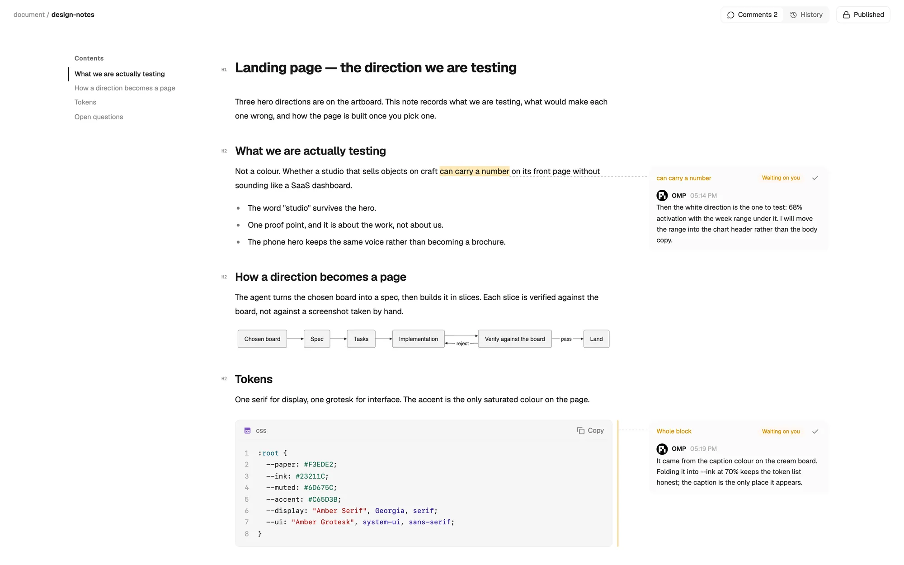
</picture>

The agent asks its questions inside the doc and links the boards it drew. Comment on a sentence or
edit in place; your edits and the agent's merge live.

## Whiteboard — sketch the structure together

**Use it when** the parts and arrows are still the question.

<picture>
  <source media="(prefers-color-scheme: dark)" srcset="docs/images/whiteboard-dark.webp">
  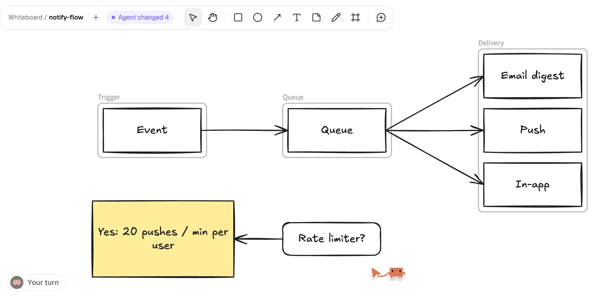
</picture>

You both draw on it. Select what you drew, ask about it, and the answer lands next to your sketch.

## HTML — tune it with real controls

**Use it when** one thing needs tuning: a component, a type scale, a motion.

<picture>
  <source media="(prefers-color-scheme: dark)" srcset="docs/images/html-dark.webp">
  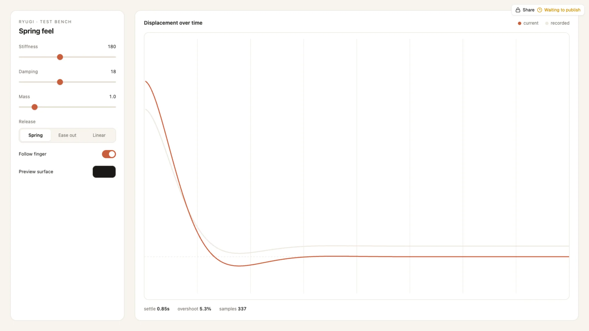
</picture>

A one-page bench whose sliders keep their values when the agent rewrites the page.

## Slides — a deck you can present

**Use it when** you will stand in front of people with it: a talk, a team share-out, a launch.

<picture>
  <source media="(prefers-color-scheme: dark)" srcset="docs/images/slides-dark.webp">
  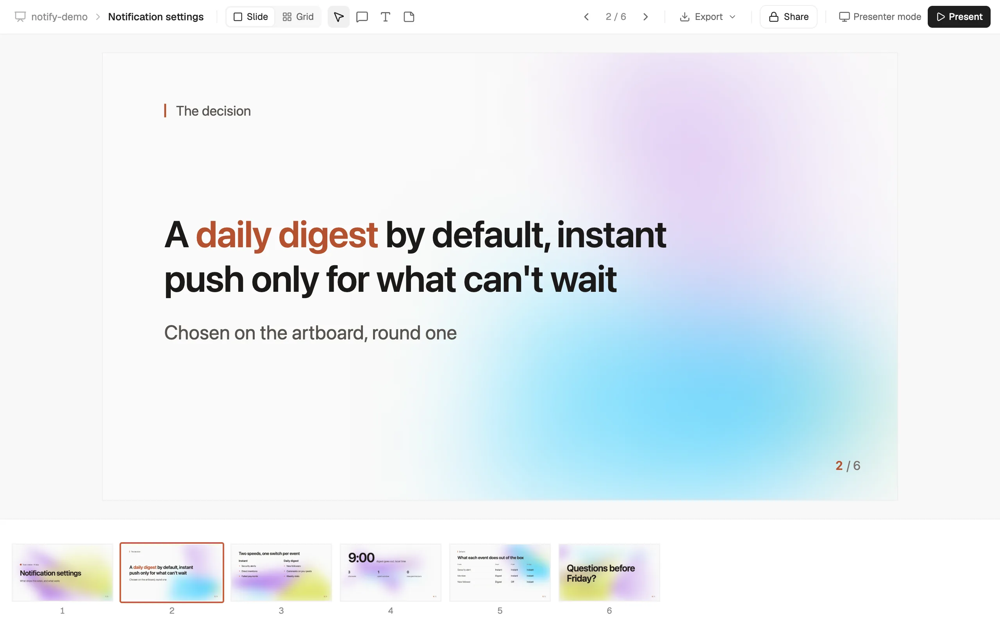
</picture>

The agent writes the deck and it follows your light or dark look. Present it full screen, or in
presenter mode with your notes and the next slide on your screen and the audience on another. Click
a slide to fix a word, restyle or move a block yourself, or pin a comment for the agent.

## Report — numbers from your real data

**Use it when** the answer is numbers: commits per week, bundle size across releases, a benchmark.

<picture>
  <source media="(prefers-color-scheme: dark)" srcset="docs/images/report-dark.webp">
  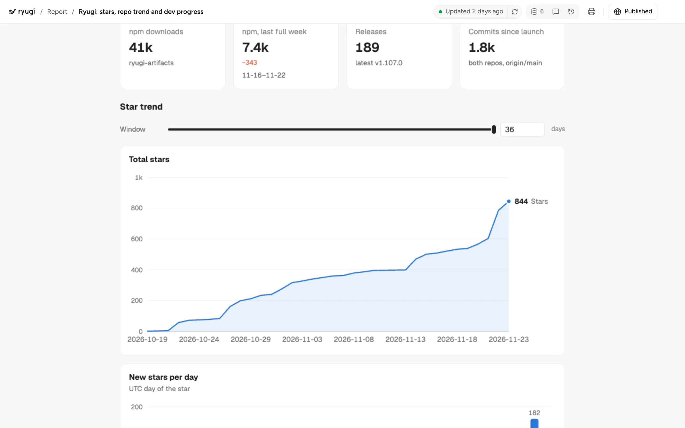
</picture>

Each data source is a script in the report's folder that prints JSON. The page draws stats, tables
and charts from it, with sliders and toggles to slice the data. Refresh reruns the scripts on your
machine, and a comment can point at one row or one point on a chart.

## Storyboard — plan and cut a demo video

**Use it when** you are making a product video: a launch film, a tutorial, a feature demo.

<picture>
  <source media="(prefers-color-scheme: dark)" srcset="docs/images/storyboard-dark.webp">
  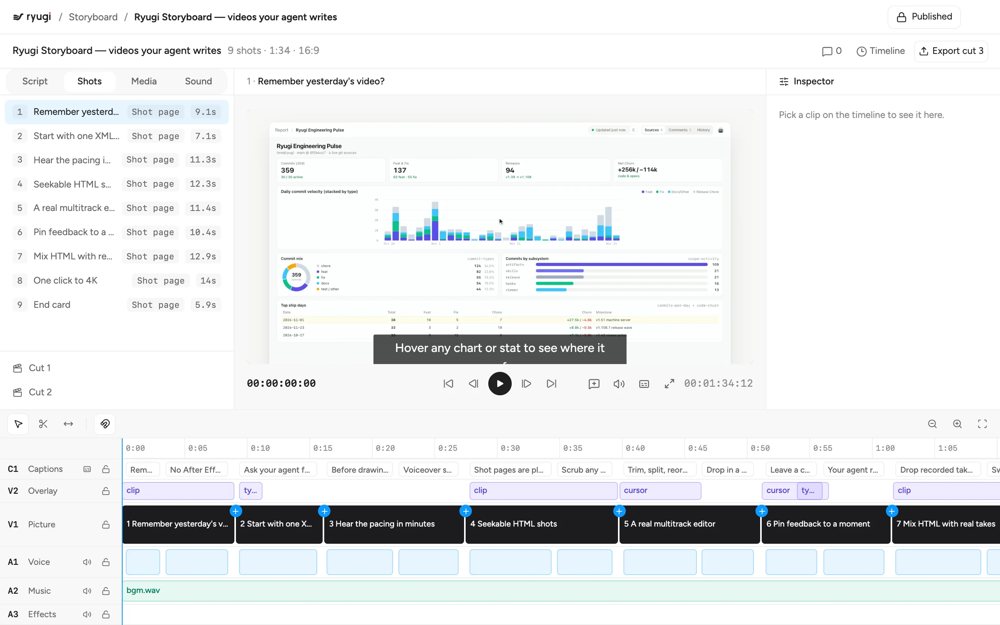
</picture>

The agent writes the shots in order, what happens on screen and the voiceover, and the page plays it
back with captions before anything is recorded. Then you cut it in the editor — a monitor, a bin
and a multitrack timeline for captions, overlays, picture, voice, music and effects — trimming,
splitting, reordering and adding transitions, and export the result.

## Verify — you pass or reject

**Use it when** the work is built and you decide whether it matches.

<picture>
  <source media="(prefers-color-scheme: dark)" srcset="docs/images/verify-dark.webp">
  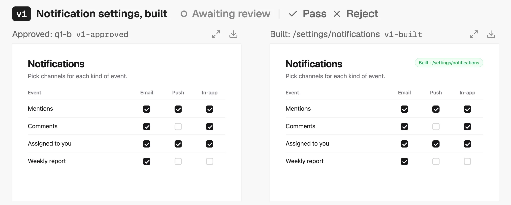
</picture>

The built page sits next to the design you approved. Pass it, or reject it and say what is off; it
comes back fixed.

What a screen can't show goes in a **verify report**: one line per claim the agent checked by
running something — a test run, an API response, a migration count, which build is deployed — with
the raw output one click away, and a "Not verified" list of what it couldn't check and why. You read
it top to bottom and pass, reject or waive; screens still get judged on the artboard, and the
report links to them.

## Comments go back to the agent

**Use it when** you'd rather point at the thing than describe it in the terminal.

Pin a comment on a board, a sentence or a sketch, and it reaches the agent session that opened the
page. In Claude Code it arrives on its own, with no message from you; the agent applies it, replies
under your comment and updates the page while you watch. Questions, picks and verdicts travel the
same way.

## Library — every artifact, one server

**Use it when** you want last week's mockup back, or a link to share.

<picture>
  <source media="(prefers-color-scheme: dark)" srcset="docs/images/library-dark.webp">
  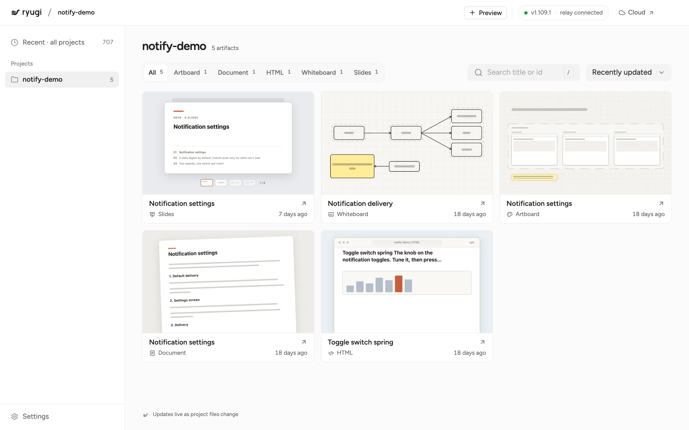
</picture>

```bash
npx artideck
```

Local first, no subscription, no agent session needed. One server covers every project on the
machine, with ⌘K to jump and links that survive a restart. `publish` shares one to
[Artideck Cloud](https://artideck.dev).

For a persistent `adeck` command without a harness plugin:

```bash
npx artideck install --mode artifacts --harness none
adeck
adeck /path/to/project
```

Node.js 20.12 or newer is required. The installer keeps a complete runtime outside
the npx cache and creates `~/.local/bin/adeck` (a command shim on Windows). It prints
PATH instructions for your shell. `npm install -g artideck` remains available;
package-manager installations keep their original update channel. `adeck update`
updates the CLI and recorded plugins; `adeck doctor` checks the install and
`adeck uninstall` removes owned entries while retaining artifacts and user data.
See the [CLI guide](docs/artifacts-cli.md) for commands and options.

## Add the full workflow

Artifacts work on their own. If you also want the agent to build from what you approved, pick the
full workflow at install (or run `adeck install --mode full --harness codex,pi` later). Its skills make
the agent reach for the artifacts at the right moment, and they fire on their own:

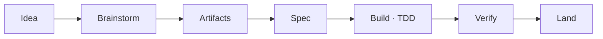

After you sign off, the agent slices the spec into tasks, proves each one red-green, keeps a ledger
of judgment calls across compaction, gets one fresh review of the branch, and reports how to land
it. Debugging and worktrees are covered too. [How it works →](docs/workflow.md)

## Work with your harness

Have Node.js and npm available in the agent's environment. The plugin calls its own launcher,
which downloads `artideck` on first use and caches each release under
`~/.cache/ryugi/artifacts/` by default. It checks for updates at most once a day and can reuse a
compatible cached release offline. The first run needs network access and a writable cache.

### Claude Code settings

Artideck replaces Claude's hosted Artifacts with the Artboard, documents, whiteboards, HTML
benches and decks. Turn the hosted ones off by adding this key to the top level of `~/.claude/settings.json` —
keep your other settings:

```json
{
  "disableArtifact": true
}
```

That is the only flag Artideck needs; leave the rest of your Claude Code settings alone.

<details>
<summary>Other harnesses</summary>

| Harness       | Command                                                                                               |
| ------------- | ----------------------------------------------------------------------------------------------------- |
| Antigravity   | `agy plugin install https://github.com/Innei/artideck`                                                   |
| Codex, Cursor | Add this repo as a local plugin source ([detail](docs/install.md#codex-cursor))                       |
| Devin CLI     | `devin plugins install Innei/artideck`                                                                   |
| Factory Droid | `droid plugin marketplace add https://github.com/Innei/artideck` then `droid plugin install ryugi@ryugi` |
| Gemini CLI    | `gemini extensions install https://github.com/Innei/artideck`                                            |
| Kimi Code     | `/plugins install https://github.com/Innei/artideck`                                                     |
| OpenCode      | [.opencode/INSTALL.md](.opencode/INSTALL.md)                                                          |
| Pi            | `pi install git:github.com/Innei/artideck`                                                               |
| OMP           | `omp plugin install https://github.com/Innei/artideck` (or `omp plugin link /path/to/ryugi`)             |
| Qwen Code     | `qwen extensions install Innei/artideck`                                                                 |
| Hermes Agent  | `hermes plugins install Innei/artideck --enable`                                                         |
| Muse          | `muse plugins install ./` then `muse plugins approve ryugi`                                           |
| DeepSeek Harness | `dsh plugin --profile <profile> add github:Innei/artideck#path:.dsh` ([detail](docs/README.dsh.md))       |

Updates and caveats: [docs/install.md](docs/install.md).

</details>

## Installing with an AI agent

This section is for the agent doing the install.

1. **Ask which install they want and wait for the answer.** Don't choose for them, and don't
   assume the full workflow: many people want only the artifacts.
   - **Artifacts only** (`--mode artifacts`): artboards, documents, whiteboards, HTML benches,
     slides, reports, storyboards and verify pages, with comments going back to the agent. The agent
     opens one when asked, or when a picture decides faster than text. How it plans and writes code
     stays the same.
   - **Full workflow** (`--mode full`): the artifacts, plus skills that run every task as
     brainstorm → spec → build under TDD → verify, with debugging and worktrees. They start on their
     own: "Let's make a react todo list" opens a brainstorm and an artboard before any code.

   If they are unsure, suggest Artifacts only; switching later is the same command with the other
   mode.

2. **Pick the harness**: the one you are running in, unless they name others. Targets:
   `claude-code`, `codex`, `cursor`, `gemini`, `opencode`, `pi`, `copilot`, `agy`, comma-separated;
   `none` installs only the `adeck` command.
3. **Check Node.js 20.12 or newer** with `node --version`.
4. **Run the installer with explicit choices.** The wizard needs an interactive terminal, so pass
   both flags and `--yes`:

   ```bash
   npx artideck install --mode artifacts --harness claude-code --yes
   ```

5. **Check it** with `adeck doctor`. If `adeck` isn't on PATH yet, pass on the PATH instructions
   the installer printed.
6. **Tell them what is left**: start a new session of the harness. In Codex, trust Artideck's hooks
   in `/hooks`. In Claude Code, offer to add `"disableArtifact": true` to
   `~/.claude/settings.json` ([why](#claude-code-settings)); change that file only if they agree,
   and keep their other settings.

Devin, Droid, Kimi Code, Qwen Code, Hermes Agent, Muse, DeepSeek Harness and OMP are not installer
targets. Their plugin commands in [Other harnesses](#work-with-your-harness) install the full
workflow, with no Artifacts-only option; say so and let them choose before you run one.

## Credits

Fork of [Superpowers](https://github.com/obra/superpowers) v7.0.0 by Jesse Vincent and [Prime Radiant](https://primeradiant.com) ([UPSTREAM.md](UPSTREAM.md)). [Issues](https://github.com/Innei/artideck/issues) and PRs welcome; [AGENTS.md](AGENTS.md) has the rules.

## License

Skills, harness integrations and docs: [Ryugi License 1.1](LICENSE) — free to
use, modify and redistribute, with two exceptions. The Restricted Parties in
Schedule A (Tencent, Alibaba, ByteDance, Baidu, Huawei, Xiaomi, Meituan, JD,
PDD, NetEase, Kuaishou, Didi, Ant Group, iFlytek, SenseTime, and products such
as WorkBuddy, Qwen, Qoder and Trae) may use and modify the skills for their own
internal work, their employees included, but may not list them in a marketplace,
ship them in a product, or train models on them for others; and nobody may
scrape the skills into a marketplace. This is source-available, not an open
source license; material derived from Superpowers and contributions made before
2026-11-04 stay MIT (Exhibit B).

The artifacts application, published to npm as [`artideck`](https://www.npmjs.com/package/artideck), is proprietary (npm `license`: `UNLICENSED`) and not part of this repository. Releases up to 1.51.2 were published under AGPL-3.0-only.
