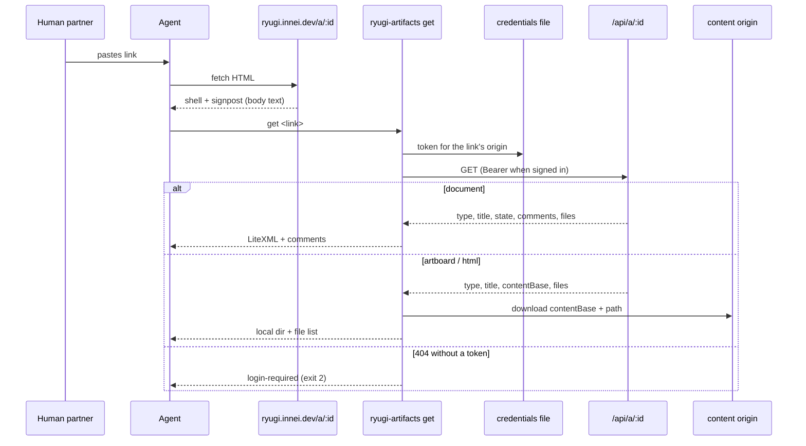
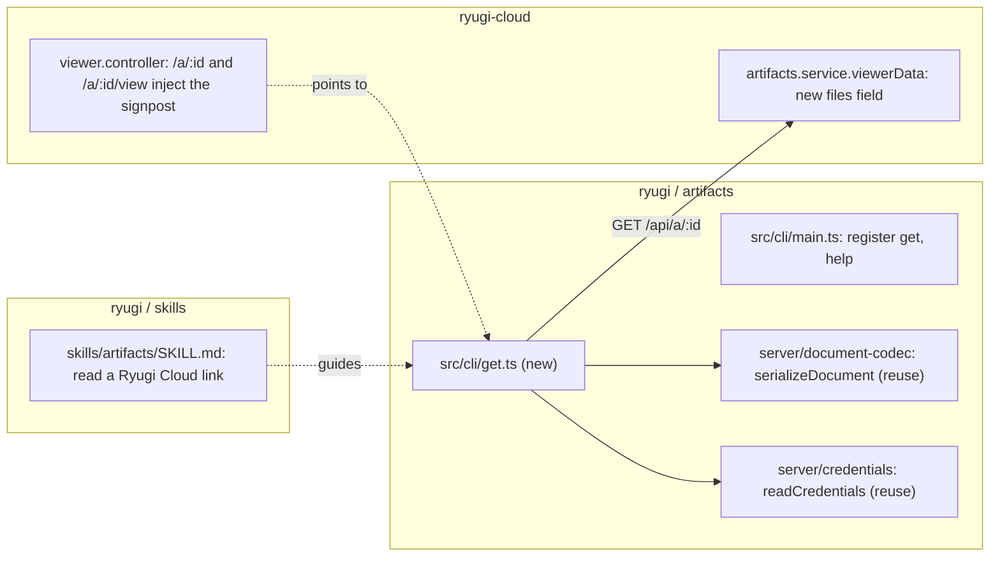

# Agent-readable Ryugi Cloud links

Approved by the human partner on 2026-10-27 after one round in the Ryugi
document `agent-readable-links`
([cloud link](https://ryugi.innei.dev/a/x56gIp3uNO6lfGLTtPGX)). They set the
direction in chat and accepted all seven round-1 recommendations; a builder
check added the calls marked "my call". Everything decided is restated here so
this file stands alone.

## Why

Pasting `https://ryugi.innei.dev/a/<id>` to an agent fails. A fetch returns the
SPA shell: no content and no hint where the source lives. The data endpoint
`/api/a/:id` answers 404 to an anonymous request for a private artifact, with
no hint that a sign-in would help. The only way that worked was scraping the
rendered text from a signed-in browser, which split every table cell onto its
own line and lost the `doc.xml` structure.

Goal: any agent that fetches the link learns, on that first fetch, which
command to run; the command uses this machine's CLI sign-in and returns the
format agents write documents in.

## Goals, non-goals, anti-goals

- **Goal:** fetching `/a/:id` or `/a/:id/view` shows a signpost in the page's
  body text.
- **Goal:** `ryugi-artifacts get <link-or-id>` returns a document's LiteXML and
  comments, or downloads an artboard's or html artifact's files.
- **Goal:** an agent with the Ryugi plugin runs `get` straight away, without
  fetching the page or opening a browser.
- **Non-goals:** writing back through `get` (edits, comments); Markdown output;
  reading the live copy served while the owner's computer is online.
- **Anti-goals:** exposing a source URL or any new raw-data endpoint to
  anonymous requests; a signpost that leaks a private artifact's title or type.

## Flow

## Where the changes land

Cloud auth needs no change: `GET /api/a/:id` already accepts
`Authorization: Bearer` through `requestSession`
(`ryugi-cloud/src/common/request.ts`), and the CLI's token is an `api` session.

## Signpost (ryugi-cloud)

- **Where:** only `GET /a/:id` (`viewer.controller.ts` `shell`) and
  `GET /a/:id/view`. `web/index.html` also serves /home, /account and others,
  so the template itself stays untouched. (accepted + my call)
- **Two copies:** `<meta name="ryugi:agent" content="…">` in `<head>`, and a
  visually hidden plain-text paragraph inside `
` that the app
  replaces when it mounts. Many fetch tools turn HTML into Markdown and drop
  `<head>`, so the body copy is the one that matters. (accepted)
- **Text:** identical for every artifact apart from the link, with no title or
  type, in English since the reader is an agent:
  `This is a Ryugi Cloud artifact. Agents: read its source with
\`npx -y ryugi-artifacts@latest get https://ryugi.innei.dev/a/<id>\`.
  Private artifacts need a Ryugi sign-in on this machine; the command says
  how.` (my call)
- **Check:** the text is absent from the accessibility tree, never flashes
  visibly, and is gone from `#root` once the app mounts.

## Cloud field

`viewerData` returns `files: string[]` when published: the current version's
paths from `version_files`. Paths only, no hashes; access is the same as
`contentBase` today. (my call)

## `get` (CLI)

1. **Arguments:** `https://<origin>/a/<id>` (also with `/view` or `/preview`)
   or a bare id. A bare id uses `RYUGI_CLOUD_ORIGIN`, defaulting to
   `https://ryugi.innei.dev` as in `lifecycle.ts`. Ids match
   `^[A-Za-z0-9_-]{1,64}$`, as `publish --delete` does.
2. **Sign-in:** `credentialsFile(process.env, process.platform, os.homedir())`
   and `readCredentials(file, origin)`. With a token, send Bearer; without
   one, request anonymously. No running server, no `--project-dir`.
3. **Request:** `GET <origin>/api/a/<id>`. 404 without a token → exit 2 with
   `login-required`; 404 with a token → error "not found or no access"; 429 →
   pass the cloud's `error` and `code` through; `published: false` → error
   "not published yet".
4. **Document:** `serializeDocument(state)` LiteXML, then a comments section:
   each non-deleted thread as `[blockId] "quote"`, one `author: text` line per
   message, `(resolved)` on resolved threads. `--no-comments` drops the
   section. `--json` prints one line
   `{type:"artifact", artifactType, id, title, visibility, updatedAt, content, comments}`
   with the cloud's threads. When the document references files
   (``, `<excalidraw>`, `<dynamic>`), the `files` other than `doc.xml`
   download as in step 5; text output starts with `Files: <dir>`, `--json`
   adds `dir`. No such files, no directory. (my call)
5. **Artboard / html:** download every `files` entry from
   `contentBase + path` into `--out`, or `~/.cache/ryugi/get/<id>/` emptied
   first on each run. An artboard also writes the payload's `canvas` as
   `canvas.json`. Text output is the directory and the file list; `--json` is
   `{type:"artifact", artifactType, id, title, dir, files}`. Reject paths that
   escape the directory. (my call)

Help gains: `get  Read a published Ryugi Cloud artifact by link or id: [--out <dir>] [--no-comments]`.

**Output mode differs from the other commands.** They default to JSON when
stdout is not a TTY (`argv.includes('--json') || !process.stdout.isTTY` in
`main.ts`). `get` prints JSON only with an explicit `--json`; otherwise stdout
is the source, terminal or not, because the signpost's command has no
`--json` and agents run without a TTY. In source mode errors go to stderr as
one plain line (`login-required` too) with the same exit codes (2 sign-in,
1 otherwise); `--json` errors match the other commands. (my call)

**Sign-in.** Signing in needs a running server for the callback
(`publish --login`); `get` does not start one. The `login-required` message:
"Sign in once with \`ryugi-artifacts start\` then \`ryugi-artifacts publish --login\`
in any project, then run this command again." The partner's machine is
already signed in, and Codex and Claude read the same credentials file, so
this is rare. (my call)

## Skill (skills/artifacts/SKILL.md)

Add "Read a Ryugi Cloud link": when the human partner pastes a
`ryugi.innei.dev/a/` link (or another Ryugi Cloud origin), run
`node app/ryugi-artifacts.cjs get --json <link>` first, not a page fetch or a
browser; read `content` for a document, the files in `dir` otherwise. English
only.

The section goes **before** the "You have a tool named `Artifact`" branch, or
Claude Code users are sent to `claude-artifacts.md` and never see it. The
frontmatter `description` gains a trigger at the end: "or when they paste a
Ryugi Cloud link (…/a/…) to read". A body-only change may never load the
skill on "read <link>". (my call)

Per `AGENTS.md`, test this with `writing-skills`: same prompt "read <link>"
before and after; before, record how the agent fetches; after, confirm its
first step is `get`. Keep the results with the change.

## Tests

| Where                                                   | What                                                                                                                                                                                                                                                 |
| ------------------------------------------------------- | ---------------------------------------------------------------------------------------------------------------------------------------------------------------------------------------------------------------------------------------------------- |
| `artifacts/test/cli-get.test.ts` (with `fake-cloud.ts`) | link and bare-id parsing; Bearer and anonymous requests; document LiteXML and comments, `--no-comments`, `--json`; document files; artboard/html download, `../` rejected; 404 with and without a token, 429, unpublished; source mode without a TTY |
| ryugi-cloud viewer tests                                | meta and body signpost on `/a/:id` and `/a/:id/view`; none on other pages; no title or type for a private artifact                                                                                                                                   |
| ryugi-cloud artifacts tests                             | `viewerData.files` equals the current version's paths; absent when unpublished                                                                                                                                                                       |
| By hand                                                 | `curl` the cloud link shows the body signpost; `get` from another directory returns this design document's LiteXML                                                                                                                                   |

## Release order

1. ryugi-cloud first (signpost and `files`), deployed from the local build as
   usual.
2. Then ryugi-artifacts: changes under `artifacts/src/` need a version bump and
   tag through the Release workflow.
3. The skill change ships in the same release as the CLI.

The signpost says `@latest`, so between the cloud deploy and the npm publish
its command does not exist yet. Keep the two releases close; no compatibility
shim. (my call)

## Left to the builder

- The visually-hidden CSS and which function injects it (a sibling of
  `withShareMeta` fits).
- Exact layout of the comments section, within step 4's fields.
- Download concurrency.

## Artifacts used

- document `agent-readable-links` (`.ryugi/artifacts/document/agent-readable-links/`,
  [cloud link](https://ryugi.innei.dev/a/x56gIp3uNO6lfGLTtPGX)): round 1 settled
  all three types, the `get` command with source output and a `--json`
  wrapper, LiteXML for documents, comments included, signposts in head and
  body, `npx` in the signpost, and a SKILL.md section.
- The sample that exposed the problem: document `paOMLK_jHrmmMcyUNhLR`,
  "平台适配与 Docker 自部署设计".
