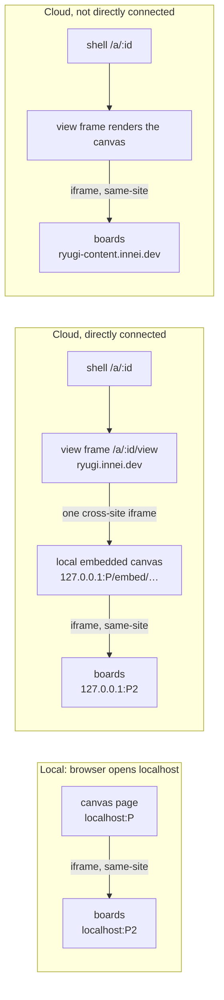

# Artboard rewrite: always-mounted boards, idle unload, embedded local canvas, no access key

Agreed with the human partner on 2026-10-31, in chat and in the Ryugi document
`document/artboard-rewrite` (https://ryugi.innei.dev/a/Hd1EUxoadtn7g3xINjFZ).
Supersedes `2026-10-27-artboard-board-rendering-rules-design.md` and
`2026-10-28-live-board-budget-design.md`.

## Why

To keep zoom smooth, the artboard canvas grew a tier system: four board
states (`live`, `snapshot`, `placeholder`, `empty`), a live-board budget,
hover wake-up, kept boards, warming, a 1.5 s linger and an 8 s mount timeout.
The rules interact, and each fix broke another edge case. The typical failure:
a trackpad pinch unmounts an iframe that has no snapshot yet, and the board
turns into its title text.

A benchmark (the 30-board Cursor artboard, see Evidence) showed that the cost
is not the number of iframes but Chrome's process isolation.
`sandbox="allow-scripts"` gives every board an opaque origin, Chrome puts
sandboxed opaque-origin frames in a separate process, and every zoom frame then
waits on that process. When boards are same-site with the canvas that frames
them, 30 mounted boards zoom at 60 fps.

So this is a rewrite, not another patch: the canvas always shows the real
iframe, and only a board that has been idle for a long time and can be
captured is swapped for a capture of the same file version.

## Goals

- Trackpad zoom on the local canvas and on the Cloud canvas (including Cloud
  directly connected to the local server) at P95 ≤ 18.2 ms per frame
  (≥ 55 fps).
- The canvas shows only a real iframe or a capture of the same file version.
  No title-text covers, no blank placeholders.
- Boards idle for a long time unload to bound memory; a board that cannot be
  captured never unloads.
- With Cloud directly connected, boards still load straight from the local
  server, never through Cloudflare.
- A loopback-bound local server needs no access key; local and Cloud mint
  artifact ids with one function.

## Non-goals

- `PhoneBoard` is not rewritten; it only switches to the new board origin and
  the idle-unload controller (see "Phone and other consumers").
- HTML artifacts and document `<dynamic>` blocks are out of scope. They have
  no zoom problem, keep their opaque-origin sandbox, and stay on the main port.
- One Cloud subdomain per artifact (needs a second-level wildcard certificate).
- Pausing board animations during a gesture. Measured: no gain at normal CPU;
  at 4× CPU throttle fewer slow frames but single hitches of 67–217 ms from
  restyling 30 documents.
- Safari direct connection stays a non-goal (Safari uses the relay).

## Anti-goals

- Unloading boards during a gesture, or by count or memory budget.
- Any board on screen rendered as a title cover or blank.
- After dropping the key, any web page (including DNS rebinding, and pages
  that know an artifact id) reading local artifacts, writing comments or
  publishing. Comments reach the agent's session, so writing a comment is
  remote control of the agent.
- Loading boards through Cloudflare while directly connected.
- A board served from the same origin as the canvas that frames it: with
  `allow-same-origin`, a same-origin frame can remove its own sandbox.

## Constraints

- Zero runtime dependencies for the plugin; new files under `artifacts/` are
  AGPL-3.0-only (`AGENTS.md`).
- Users install from `main`; any change under `artifacts/src/` ships as a
  release. Old and new local servers and Cloud coexist for a while (see
  Rollout).
- Cloud (`ryugi-cloud`) consumes the viewer through the `ryugi-artifacts` npm
  package. Release order as today: deploy Cloud from the local build first,
  then publish npm.
- Chrome asks for local network access permission for fetches and frames to
  127.0.0.1. The Cloud shell already sets
  `allow="clipboard-write; local-network-access; loopback-network"` on its
  frame and probes with `probeLoopback`; any new nested frame must pass the
  permission down.
- Edits under `skills/` follow the `writing-skills` process ("Skills Are Code"
  in `AGENTS.md`).

## Structure

In all three cases boards are same-site with the canvas that frames them and
share its process. The directly connected Cloud page adds one process boundary,
between the view frame and the local canvas; zooming inside the canvas does
not re-raster across it.

## Evidence

Throwaway spike: one page, 30 iframes, one transformed world element. Gestures
are CDP ctrl+wheel events, 60 Hz display, frame times from rAF in the canvas
document. Zoom P95, 2–3 runs per row.

| Case                                                                            | Zoom P95     | Notes                                              |
| ------------------------------------------------------------------------------- | ------------ | -------------------------------------------------- |
| Same-site, off-screen `display:none`, `will-change` during gesture              | 17.4 ms      | 60 fps                                             |
| Same, without culling or `will-change`                                          | 17.5 ms      | occasional 183–667 ms hitches                      |
| `sandbox="allow-scripts"` (today)                                               | 33–50 ms     | 20–30 fps                                          |
| Same, Chrome `--disable-features=IsolateSandboxedIframes`                       | 17.5 ms      | confirms process isolation is the cost             |
| Same-site other port, `allow-scripts allow-same-origin`, pointer inside a board | 17.5 ms      | worst frame 18 ms                                  |
| Cross-site (today's Cloud direct mode)                                          | 33–34 ms     | per-board or per-frame `will-change` does not help |
| Whole local canvas embedded in a cross-site shell                               | 17.3–17.6 ms | same with the pointer inside a board               |

Memory: 30 mounted same-site boards add ~135–180 MB of Chrome RSS; sandboxed,
264 MB. Order of magnitude only.

The fixture is the Cloud artboard "Cursor · AI 光效与尺寸 ×2"
(https://ryugi.innei.dev/a/EdRyTU3BvwYu8LglNe74): 30 boards (15 pages used
twice) with infinite CSS animations, `backdrop-filter`, conic gradients and
masks. The spike files lived in a session scratchpad and are gone; the bench
below replaces them.

## Design

### Canvas: always mounted

- **View state.** No `setView` per wheel event. The view lives in a ref; one
  write per rAF sets the world element's `transform` and a `--zoom` CSS
  variable for counter-scaled labels and outlines. React consumers of the view
  (toolbar zoom percentage, overlay positioning) subscribe to an external
  store and update per rAF or on gesture end. _(Our call: today every wheel
  event re-renders React; the spike shows direct DOM writes suffice.)_
- **Gesture state.** A zoom or pan enters `gesturing`: the world gets
  `will-change: transform`, every board iframe gets `pointer-events: none`.
  150 ms after the last event it exits: `will-change` is removed so content
  re-rasterizes crisply at the new scale, and pointer events come back.
- **Off-screen culling.** Each rAF during a gesture and on gesture end, compute
  board screen rects; a board fully outside the viewport plus 240 px gets
  `display: none`. The iframe stays mounted.
- **Gestures starting inside a board.** The board runtime already forwards
  ctrl+wheel as `ryugi:inspect:wheel`; the canvas maps it into canvas space.
  Once the gesture starts, iframes stop taking pointer events, so the rest of
  the gesture lands on the canvas.
- **Board identity.** Messages are matched by `contentWindow === event.source`,
  as `useInspector` and `useBoardTweaks` do now, never by origin string.
- **Removed.** `useHoverDwell`, `useKeptBoards`, `live-limit`, `board-tiers`,
  `tier-controller`, `useBoardTiers`, the title-cover layer, the IndexedDB
  `snapshot-store`, and their tests.
- **Debug.** Keep the `?debug` HUD: fps, worst frame, slow frames, and board
  counts by state (mounted, culled, unloaded, uncapturable).

### Idle unload

Each board has a last-active time, set to now whenever any of these holds:

- it intersects the viewport;
- the pointer is over it;
- it was clicked or typed into (`ryugi:board:interacted`);
- it is selected, inspected, being commented on, or has its parameters panel
  open;
- it is playing video or a prototype;
- the agent just changed its file (`ryugi:board:changed` or a version bump).

Unloading:

1. **Candidate.** Idle for 5 minutes (`IDLE_UNLOAD_MS = 300000`) and no
   gesture in progress. No count cap, no memory-pressure trigger.
2. **Capture.** Ask the board for a capture over the existing
   `ryugi:board:capture` protocol (`inspector/snapshot.ts`), recording the file
   version. Failure, more than 10 s, or a blank result (zero width or height,
   fully transparent) marks the board uncapturable for that version: no
   retries until the version changes, and it never unloads. A capture that is
   not blank but imperfect (`backdrop-filter`, video, cross-origin images)
   still counts; it only shows briefly when panning fast into an idle area.
3. **Swap.** If the capture matches the current version, show it in place
   (object URL, memory only) and remove the iframe on the next frame. If the
   board becomes active during capture, abandon the unload.

Restoring:

- When an unloaded board comes within one viewport of the visible area, is
  clicked, or is targeted by a comment, remount the iframe under the capture;
  remove the capture on the frame after `ryugi:board:ready`, or after 8 s
  without ready.
- Nothing mounts or unmounts during a gesture; it waits for gesture end.
- A file change while unloaded marks the capture stale and keeps the board
  unloaded; restoring mounts the new version and shows the stale capture until
  ready.
- A comment-mode click on an unloaded board records a board-level anchor at
  once (today's fallback) and restores the iframe.

The rules live in a pure controller: input boards, viewport, activity signals,
capture state and a clock; output `mounted` or `unloaded` per board; unit
tested with a fake clock. _(Our call.)_

### Board origin and isolation

- **Local.** The server listens on a second port for board content only, no
  API. The board host always matches the canvas host: canvas on
  `localhost:P` means boards on `localhost:P2`; `127.0.0.1` likewise. Content
  paths use the artifact address, `/c/<type>/<id>/<file>`, replacing the
  per-start random `contentToken`. The board port accepts only 21-character
  addresses, not directory slugs.
- **Iframes.** Artboard boards only (`Canvas.tsx`, `ExpandedBoard.tsx`,
  `PhoneBoard.tsx`, `PreviewView`), local and Cloud:
  `sandbox="allow-scripts allow-same-origin allow-forms allow-popups allow-modals allow-downloads"`.
  HTML artifacts and document `<dynamic>` blocks keep today's sandbox and move
  from `/c/<contentToken>/` to `/c/<type>/<id>/` on the main port.
- **Headers.** Drop the `sandbox` directive from the board content CSP, both
  local (`app.ts:123`) and Cloud `CONTENT_CSP.artboard`
  (`content.service.ts:30-35`); a header `sandbox` forces an opaque origin
  whatever the iframe attribute says. Add `worker-src 'none'` so boards cannot
  register service workers. The board port also sends `frame-ancestors` with
  the local canvas origins and the configured Cloud origin.
- **Cloud isolation.** All boards share `ryugi-content.innei.dev`. Shared
  localStorage is accepted; service workers are blocked; content access still
  needs the HMAC path grant. HTML and document content stay opaque and share
  nothing with boards.
- **Fallback to one port.** The board port is persisted like the main port
  (reused across restarts when free) and reported in `server-info` and
  `start` output. The canvas probes it on load; if unreachable (SSH or VS Code
  forwarding only the main port), it falls back to today's mode: boards from
  the main port with an opaque sandbox. Everything works, zoom drops to
  ~30 fps, and the `?debug` HUD says so. A non-loopback (key mode) server
  always uses this mode. _(Our call.)_
- **Cloud self-host.** The speed-up needs the content and app origins to be
  same-site. The self-host config (`src/platform/bun/settings.ts`) only
  requires them to differ; log a warning at startup when they are not
  same-site. _(Our call; self-hosting itself is still deferred.)_

### Cloud direct mode embeds the local canvas (artboards only)

- **Structure.** The shell `/a/:id` is unchanged. The view frame `/a/:id/view`
  keeps owning the connection (relay first, then direct). Once direct is live
  and the local server advertises `embed: true` in its relay `hello`, the view
  frame stops rendering `ArtboardView` and renders one full-canvas iframe to
  `http://127.0.0.1:<port>/embed/artboard/<id>` with
  `allow="clipboard-write; local-network-access; loopback-network"`.
  _(Our call: the connection logic already lives in the view frame.)_
- **Embed page.** The local canvas in embed mode: no header; comments,
  inspector, parameters and idle unload all inside. It talks to its own server
  over same-origin `/ws` and API calls. Its CSP has
  `frame-ancestors <cloud origin>`; ordinary local pages keep
  `frame-ancestors 'none'`.
- **Messages.** Extend `ryugi:cloud-header` into a two-way protocol between
  the embed page and the view frame, each side posting to the other's explicit
  origin and checking both `event.source` and `event.origin`. The view frame
  forwards to the shell over the existing channel.
  - Embed → view: title, publication, online state, shortcuts the canvas does
    not handle.
  - View → embed: theme, language, thread to focus, and the existing shell
    commands such as `ryugi:publish`.
- **Disconnect.** When direct drops, or the embed misses heartbeats for 5 s,
  the view frame removes the iframe and renders the canvas itself over the
  relay, with boards from the `ryugi-content` live route.
- **HTML and documents** are not embedded; they keep today's direct mode.

### Dropping the access key

On a loopback-bound server (default `127.0.0.1`), these replace the key, the
`ryugi_artifacts_<port>` cookie and `contentToken`:

1. **Host allowlist.** Every request and WebSocket upgrade, on both ports,
   must have Host `127.0.0.1:<port>`, `localhost:<port>` or the configured
   `--url-host` with the port; anything else gets 403. This stops DNS
   rebinding.
2. **Origin rules.** A request carrying Origin must come from a local canvas
   origin (the hosts above with the port). The direct relay and the embed page
   also accept the configured Cloud origin. Requests without Origin (CLI,
   curl, other local processes) pass; every mutating route accepts only POST,
   PUT or DELETE, which browsers always send with Origin when cross-origin.
3. **Routes without an id.** The library page `/` is served only when
   `Sec-Fetch-Site` is `none` or `same-origin`. `/api/artifacts`,
   `/api/status`, `/ws` and `/api/cloud/*` accept same-origin only. No CORS
   headers anywhere.
4. **Ids are addresses, not secrets.** Ids appear in public share links and
   local routes also accept directory slugs, so nothing relies on an id being
   unknown. Other sites are kept out by rules 1–3 plus the board port's
   `frame-ancestors`, which stops a foreign page from framing a board and
   reading it through the runtime (`ryugi:board:capture`, the inspector). The
   runtime answers only messages whose `event.source === parent`. The direct
   relay becomes `/relay/a/<id>`, checked by Cloud Origin and the Host
   allowlist.

A server bound to a non-loopback address (`--host 0.0.0.0`, containers and
remote dev) still requires the key, using today's `?key=` and cookie, now only
in that mode.

Follow-on changes:

- CLI `serverClient`, `start` `link` and `monitor` omit the key on loopback.
- `server-info` `url` no longer contains the key.
- Relay `hello` `local.key` becomes optional and is omitted on loopback.
- Cloud `LocalHost` validation and `liveConnection` candidates dedupe by
  `[hostId, port]`.
- `skills/artifacts/SKILL.md` (lines 104–137, `?key=` guidance) is updated.

### One artifact id scheme

- `ryugi-artifacts` `shared/ids.ts` exports `mintArtifactId()`: 21 characters
  from the 62-character alphanumeric alphabet, as
  `server/artifact-address.ts` does now. The local server uses it; Cloud
  imports it for new artifacts.
- `createRecord` (`server/cloud.ts`) sends the local address as `id`. Cloud
  `CreateArtifactDto` gains an optional `id` that must match the 21-character
  form; a taken id returns 409. Without `id`, Cloud mints one with
  `mintArtifactId()`.
- On 409 the local side keeps its address and falls back to today's path:
  Cloud mints, local keeps the `cloud.id` mapping.
- No migration: existing 20-character Cloud ids stay valid, local `cloud.id`
  mappings stay, old links open. Every id validator accepts both lengths.

### Phone and other consumers

- `PhoneArtboard` uses `useBoardTiers` (`preview: true`) today; it switches to
  the same idle-unload controller and culling. _(Our call.)_
- `PreviewView` uses only `visibleRenders`; it switches to the new culling.
- Cloud `CloudSnapshot`'s `tiers` prop on `ArtboardView` and
  `publishPayload`'s `snapshots: true` are removed. Cloud thumbnails are
  server-rendered schematic SVGs (`ryugi-artifacts/thumbnail`) and do not use
  captures.

## Rollout

- **Cloud first.** Cloud must work with old local servers (with key) and new
  ones (without). `LocalHost.key` is optional; embed mode only when `hello`
  advertises `embed: true`, otherwise today's direct mode. The content CSP
  change ships with the viewer version Cloud pins.
- **Local server second.** On loopback, a new server ignores a `?key=` in old
  links.
- **Release** per `AGENTS.md` Releasing: `scripts/bump-version.sh`, tag, push;
  Cloud deployed from the local build first.

## Verification

- **Bench.** `artifacts/bench/zoom/` with `pnpm bench:zoom`: launches Chrome,
  opens a 30-board fixture built from the Cursor artboard pages, runs idle,
  pinch and pan phases, and prints P95, worst frame and slow frames for two
  scenarios: the local canvas, and the local canvas embedded in a cross-site
  shell. Pass: zoom P95 ≤ 18.2 ms in both. Needs local Chrome; not in CI.
- **Unit tests.** The idle-unload controller (fake clock, every rule above);
  the auth rules (Host allowlist, Origin, `Sec-Fetch-Site`, loopback and key
  modes); `mintArtifactId`; Cloud `id` on create and 409; embed message
  validation; fallback from embed to Cloud rendering; board-port fallback.
  Tests for removed modules go with them; `server.test.ts` and the other auth
  tests are rewritten for the new rules.
- **By hand.** Real trackpad on the local canvas and on Cloud direct, including
  pinching with the pointer inside a board. Comments: click an element,
  marquee, jump to a thread, comment on an unloaded board. Focus and shortcuts
  (fixed in 1.46.2) again in embed mode. Safari and Firefox no worse than
  today.
- **Security by hand.** Point `evil.test` at 127.0.0.1 in `/etc/hosts`, open
  `http://evil.test:
/`, expect 403. Frame a board URL from another origin,
  expect it blocked.

## Left to the builder

- Module split and names (500 lines per file, components under 300).
- The view store's shape (`useSyncExternalStore` or similar).
- How the second port is opened and recorded in `server-info`.
- The embed heartbeat interval.
- Bench fixture contents and driver details.

## Decisions

| Decision                                                                                                                                                          | By                                                    |
| ----------------------------------------------------------------------------------------------------------------------------------------------------------------- | ----------------------------------------------------- |
| Rewrite the canvas module instead of patching                                                                                                                     | human partner                                         |
| Zoom target P95 ≥ 55 fps                                                                                                                                          | human partner                                         |
| Boards on their own same-site origin: second local port, `ryugi-content` on Cloud                                                                                 | human partner                                         |
| Boards always mounted, off-screen `display:none`, `will-change` and `pointer-events:none` during gestures                                                         | proposed, agreed, from the benchmark                  |
| Boards never load through Cloudflare in direct mode                                                                                                               | human partner                                         |
| Direct mode embeds the whole local canvas                                                                                                                         | proposed, agreed                                      |
| One shared Cloud content origin with `allow-same-origin` and `worker-src 'none'`                                                                                  | proposed, agreed                                      |
| Idle unload: 5 min idle, capture first, never unload uncapturable boards, nothing during gestures                                                                 | direction by human partner, rules proposed and agreed |
| Imperfect but non-blank captures still allow unloading                                                                                                            | proposed, agreed                                      |
| No animation pausing during gestures                                                                                                                              | proposed, from the benchmark                          |
| Drop the key; ids are addresses                                                                                                                                   | human partner                                         |
| Host allowlist, Origin rules, `frame-ancestors` on the board port, key only when non-loopback                                                                     | proposed                                              |
| One id function for local and Cloud                                                                                                                               | human partner                                         |
| Canvas rewrite and key removal in one project                                                                                                                     | human partner                                         |
| View written to the DOM; embed iframe inside the view frame; phone uses the same controller; one-port fallback; self-host same-site warning; artboard boards only | our call                                              |
