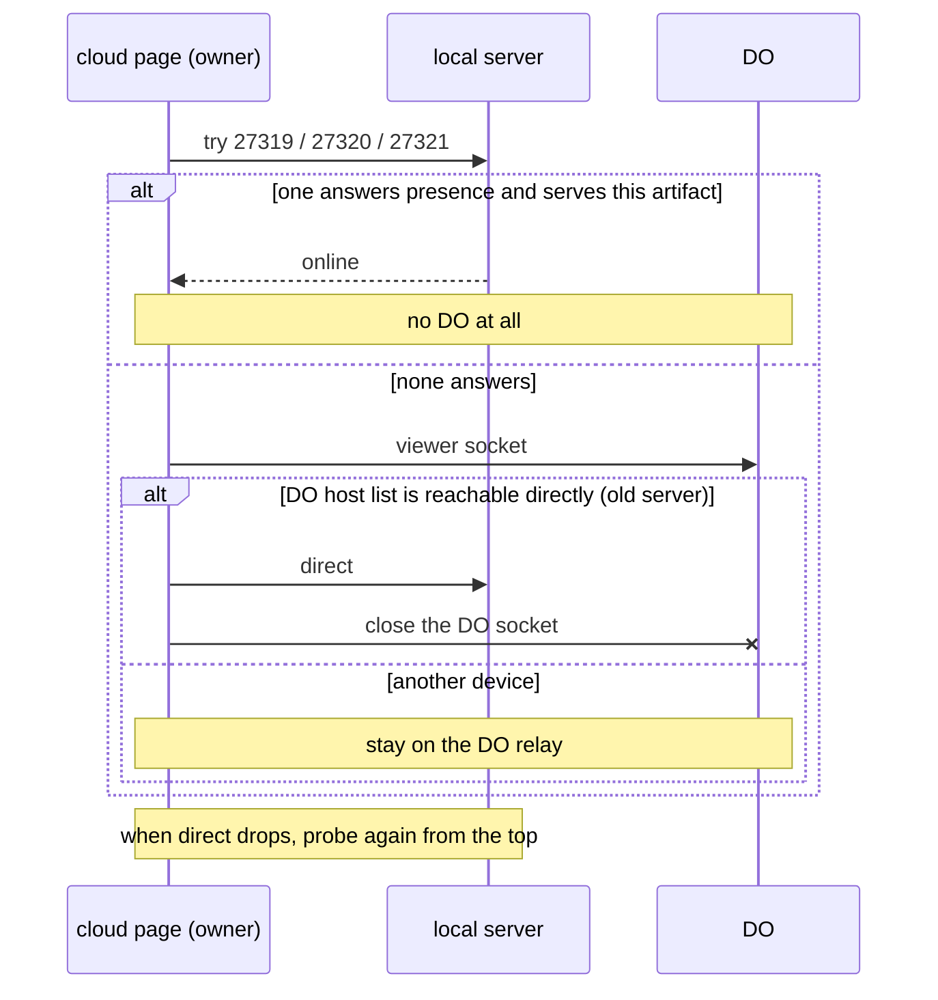

# Global artifacts server: one resident server per machine

Approved 2026-11-01. Decided in the document artifact
`document/global-artifacts-server` (https://ryugi.innei.dev/a/4BGfi1fNUYZdjtOHH19H4)
and the artboard `artboard/server-home`
(https://ryugi.innei.dev/a/BY0DbbUNsbcTMQYRQQ0an). Spans two repos:
`ryugi` (CLI, server, viewer, hooks, skill) and `ryugi-cloud` (relay and web
client).

## 1. Why

Today every project starts its own server: pid, port, key and owners live in
the project's `.ryugi/artifacts/.state/`. The port falls back to a random one,
each server opens its own cloud relay, and the server exits when every owner
session has exited or after 4 hours idle. `monitor` exists to list and clean up
these scattered processes.

What goes wrong: with several projects open there is a pile of node processes;
random ports mean the localhost address keeps changing; relays are handled per
server; the server exits on idle and cloud pages go offline.

### Root cause found while designing: cloud pages stuck "offline"

Every open cloud page holds a Durable Object (DO) viewer socket for its whole
life, even after it has connected directly to the local server. The DO allows
10 viewer sockets per account (`ryugi-cloud/src/relay/relay-room.ts:27`). Once
10 tabs are open, every new page's handshake gets HTTP 429 from `RelayHub`, and
the client retries every 1-3 s. A browser WebSocket cannot read the 429 body,
so the page only shows "offline". Closing the other tabs fixed it (verified by
the human with `wrangler tail`).

| Part             | Current behavior                                                                                                                       | Where                                       |
| ---------------- | -------------------------------------------------------------------------------------------------------------------------------------- | ------------------------------------------- |
| DO slots         | 10 viewer, 5 host sockets per account                                                                                                  | `relay-room.ts:27`                          |
| Page connection  | The DO socket stays open after direct connect; host list and "host online" come from it                                                | `ryugi-cloud/web/src/lib/liveConnection.ts` |
| Rejection reason | 429 is in the HTTP body, unreadable from a WebSocket; page shows offline and retries                                                   | `relay-room.ts:112-117`                     |
| Metering         | View seconds accrue on open DO viewer sockets during direct mode too; free plans burn the 4 h daily allowance (inferred, not measured) | `relay-room.ts:67-85`                       |

## 2. Goals, non-goals, anti-goals

- **Goals:** one resident process per machine; a stable local address; one
  relay connection per machine; viewing on the host machine uses no DO at all;
  DO rejections are visible with their reason; one local page to find any
  artifact across projects and to manage the server.
- **Non-goals:** autostart (launchd, systemd); direct connection from other LAN
  devices (mDNS); changing where or how artifacts are stored; changing the
  shape of cloud links; a comment inbox or cloud publishing management in the
  home page (later).
- **Anti-goals:** visitors of public links seeing a local-network permission
  prompt; hooks, comment watch or auto-publish breaking because the server is
  global; old links (`/<type>/<id>`) failing; new runtime dependencies; the
  server restarting itself while the human is editing.

## 3. Constraints

- Zero runtime dependencies; new files under `artifacts/` are AGPL-3.0-only.
- A change under `artifacts/src/` ships as a release (AGENTS.md, Releasing).
- Skill files are English only; viewer UI strings go through the viewer's i18n
  with English and Chinese.
- Release order: ryugi-cloud first (it must work with old servers), then
  `ryugi-artifacts`, then pin the new version in ryugi-cloud (memory note
  "cloud + viewer release order").
- TDD; lint and typecheck only the files changed; UI verified with
  ryugi:verifying-ui.

## 4. Design

### 4.1 Two layers of state

| Where                                          | What                                                                                                                                                                             |
| ---------------------------------------------- | -------------------------------------------------------------------------------------------------------------------------------------------------------------------------------- |
| `~/.ryugi/server/` (machine)                   | pid, server id, port, key, log, version, start lock, `server-info`, and the project registry `projects.json` (real path, registered at, last used at per project)                |
| `<project>/.ryugi/artifacts/.state/` (project) | Unchanged: warnings, layout, recordings, comment-watch subscriptions (`*-comment-watch/`), `agent`, auto-publish state. Hooks and comment watch still read and write per project |

Projects no longer get `server.pid` or `owners`. New hooks (`stop`,
`user-prompt-submit`, `flush-artifacts.cjs`, `selection-context.cjs`) read
`~/.ryugi/server/server-info` and check whether the project is registered.

**Compatibility with old hooks (agent's call):** hooks ship with the plugin
install and can be several versions behind the CLI; old hooks exit early unless
`<project>/.ryugi/artifacts/.state/server-info` exists. While running, the
server writes a compatibility `server-info` into every registered project,
pointing at the global URL, and removes them when it stops. New hooks ignore
it. Remove after two major versions.

### 4.2 Lifecycle, restart and upgrade

- Resident: drop the "all owner sessions exited" and "idle 4 hours" exits,
  the `owners` registration and `--idle-timeout-minutes`. No autostart: the
  first `start` launches it.
- The server never restarts itself in the background.
- **Windows (agent's call, the human doesn't use Windows):** run detached with
  Node's `detached` spawn instead of defaulting to foreground. Foreground came
  from Git Bash reaping `nohup` processes, which does not apply to Node's
  detached spawn. Not tested on Windows; unit tests only.
- **Codex (agent's call):** reuse a running global server; otherwise start one
  in the foreground as today. It exits with the session; the next `start`
  elsewhere launches it detached.

| Situation                                   | Action                                                                                               |
| ------------------------------------------- | ---------------------------------------------------------------------------------------------------- |
| `start` with a newer release CLI            | Replace. Same port; open tabs reconnect                                                              |
| `start` with an older release CLI           | Don't replace; reuse and print a hint. Upgrade only, never downgrade                                 |
| Local build (`local-<hash>`)                | Replace when the hash differs; a release CLI never replaces a local-build server                     |
| Process alive, `/api/status` silent for 1 s | Treat as hung: kill and restart                                                                      |
| Process gone                                | The next `start` launches it                                                                         |
| Newer version on npm, nobody runs `start`   | Server checks npm once a day; the status pill shows "update"; its panel offers "upgrade and restart" |
| Restart, stop or upgrade from the home page | Same code path as `stop` / `start`                                                                   |

Before any replace or stop, flush the auto-publish queue and document writes,
waiting at most 5 s, then exit.

### 4.3 Ports, key, server-wide settings

- Main port: first free of `27319` → `27320` → `27321`. All taken: fail and
  explain `--port`. The 27xxx range is high enough to avoid common dev servers
  and below the ephemeral ranges (macOS from 49152, Linux from 32768), so the
  OS won't hand it to an outgoing socket.
- Board port (iframe isolation): `27329`-`27331`, same rule.
- Loopback bind: no key (as today). Non-loopback bind: one machine key in
  `~/.ryugi/server/`.
- **Server-wide settings (agent's call):** `--host`, `--url-host`,
  `RYUGI_CLOUD_ORIGIN`. A `start` with different values replaces the running
  server and says why. **Per-request settings:** `--open`, the artifact to
  open, `ARTIFACTS_OPEN_CMD`; sent with the registration request so the
  running server opens that artifact once it is ready.

### 4.4 Project registry and routing

- **Registration:** `start --project-dir` and the session-start hook write the
  project into `projects.json`. A running server adds it live through a local
  API; on restart the server mounts every registered project. Project root
  resolution keeps `projectRoot()`. Session-start keeps today's condition
  (signed in, and the project has published artifacts): when it holds and no
  server runs, it launches one, so cloud links come back online with the
  first session after a reboot; otherwise it only registers (agent's call).
- **Index:** on start, scan each project's `.artifact-id` files into an index
  id → (project, type, slug), then update it from file watching. Links stay
  `/<type>/<artifactId>`: ids are 21 random characters, globally unique.
- **Dormancy:** watch only projects used in the last 7 days. Older ones are not
  watched; opening one of their links scans that project once and wakes it.
- **Cleanup:** a project whose directory or `.ryugi/artifacts/` is gone is
  dropped from the registry. The home page can also remove a registration;
  artifact files are untouched.
- **Isolation:** read only registered project roots; path checks are bounded
  by the project root.
- **Per-project settings** (agent name, auto-publish, comment watch) are read
  from the project the artifact belongs to.

### 4.5 Commands and hooks

| Command                                 | After                                                                                                |
| --------------------------------------- | ---------------------------------------------------------------------------------------------------- |
| `start --project-dir`                   | Launch if needed; register the project; print links; JSON output unchanged                           |
| `stop`                                  | Stop the machine's server; `--project-dir` accepted and ignored                                      |
| `monitor`                               | Removed, with `monitor-ui.ts`, `monitor-view.ts`, `servers.ts`, `server/registry.ts` and their tests |
| `check` / `comment` / `publish` / `get` | Same arguments; talk to the global server                                                            |

Update the server lifecycle passages in `skills/artifacts/SKILL.md` ("Every run
registers your session ... 4 hours idle", `stop --project-dir`, Windows reading
`.state/server-info`), in English, and `docs/artifacts-cli.md`.

### 4.6 Migrating old servers

The new `start` reads the old registry (`registryDir()`), sends SIGTERM to every
per-project server, then starts the global server. Old tabs need one reload
because the port changes.

### 4.7 Cloud: local connection and DO relay

- **Owner only:** probe the local ports only when `/api/a/:id` returns
  `owner: true`. Live is already owner-only (`findOwned`), so visitors never
  see the local-network permission prompt.
- **"No local server on this device" (agent's call):** persist it in
  localStorage only when the owner denies the local-network permission; then
  stop probing and show a "connect to this computer" button. All three ports
  failing only means the server isn't up (not started since a reboot, or an old
  server on a random port): no persistent flag; back off in memory and probe
  again every 30 s to 5 min. Clear the flag when the DO host list contains this
  machine's `hostId`.
- **No mDNS:** an https page may open `ws://` only to `localhost` /
  `127.0.0.1`; `ws://*.local` is blocked as mixed content.
- **Host side:** the global server opens one `/api/relay/host` and announces
  the published ids of every registered project.
- **DO rejection:** the DO accepts the handshake, then closes with code `4429`
  and a reason that tells "connections full" from "daily allowance used". On
  4429 the page **does not retry automatically**: it shows the reason and what
  to do ("10 pages are live; close other tabs, then reconnect" / "today's live
  allowance is used up; resets 00:00 UTC") with a "reconnect" button. "Offline"
  is shown only when the host really is offline.

### 4.8 Home page and server management

`http://localhost:27319/` is first for finding artifacts, second for managing
the server. Build it as board **q3-a** of `artboard/server-home`, with the ⌘K
palette as board **q3-b**.

- **Project sidebar** (chosen q1-c): pinned at the top, "Recent · all
  projects" mixes every project's artifacts by update time, with the project
  name on each card. Below it the registered projects, ordered by last use,
  each with its artifact count; dormant projects fold at the bottom; right-click
  a project to remove its registration.
- **Artifact area:** the Compact cards decided in `artboard/artifact-library`
  (round 3, `r3-compact`): 4 columns, real thumbnails, type filter on top,
  newest first.
- **Search:** the toolbar search toggles "this project / all projects"; ⌘K
  opens a global palette with results grouped by project, ↵ opens, ⌘↵ opens in
  a new tab.
- **Status pill** (chosen q2-a): top right; status dot, version, relay state,
  and an "update" badge when a newer version exists. Its panel: uptime,
  address, cloud relay (connected, ids announced), live pages (local · relay),
  the upgrade notice with "upgrade and restart", registered projects (active or
  dormant, count, remove), view log, restart, stop.
- **Log:** opened from the panel, filterable by project; read from the log in
  `~/.ryugi/server/`.
- The home page needs no key on loopback; on a non-loopback bind it needs the
  key like every other page.

## 5. Left to the builder

- How `root` in `artifacts/src/server/app.ts` (1574 lines) becomes "resolve the
  project root per artifact", and whether to split the file while doing it.
- Paths and shapes of the local APIs (registration, status, log, restart); only
  the CLI and the home page on the same machine need them.
- Wording and i18n keys for the 4429 reasons.
- How file watching is implemented.
- Component split for the status panel and the ⌘K palette, reusing the
  viewer's existing components and tokens.

## 6. Artifacts used

- `document/global-artifacts-server`
  (`.ryugi/artifacts/document/global-artifacts-server/`,
  https://ryugi.innei.dev/a/4BGfi1fNUYZdjtOHH19H4): this design, in Chinese.
- `artboard/server-home` (`.ryugi/artifacts/artboard/server-home/`,
  https://ryugi.innei.dev/a/BY0DbbUNsbcTMQYRQQ0an): round 1 chose q1-c (project
  sidebar) and q2-a (status pill); round 2 chose q3-a ("Recent · all projects"
  entry and search scope toggle) plus the ⌘K palette from q3-b.
- `artboard/artifact-library`: source of the card style (`r3-compact`).
