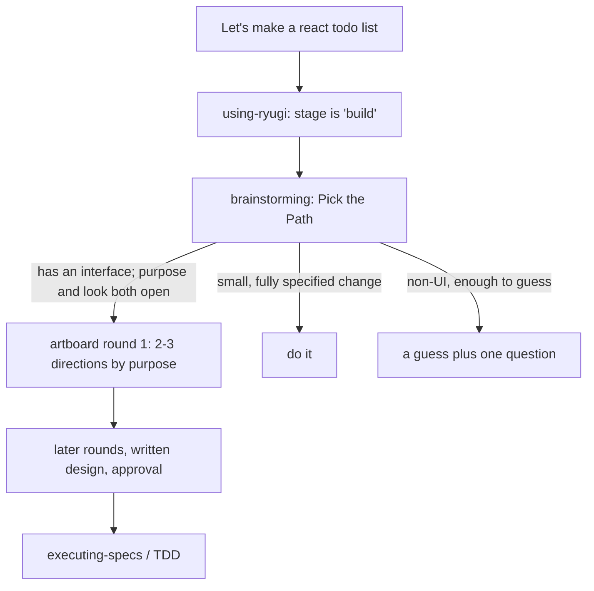

# using-ryugi rework: stage routing, and an artboard for open UI builds (Nov 8, 2026)

Discussed and approved on the document artifact `document/using-ryugi-rework`
(https://ryugi.innei.dev/a/KwtefwXFtLrnQrp7AIPsG, `.ryugi/artifacts/document/using-ryugi-rework/doc.xml`,
in Chinese). Every decision from it is restated here.

## Intent

`using-ryugi` is the bootstrap injected into every session. Its shape comes
from Superpowers v7.0.0: the 1% threshold, "invoke before ANY response",
and a 12-row Red Flags table. An ordinary question pays about 1,693 extra
input tokens for it (Haiku, 2026-10-31), and no part of it has been tested
for necessity on its own.

The flagship prompt `Let's make a react todo list` has degraded from both
ends. The 10-31 short router started implementation in 0/5 runs. The 11-03
brainstorming rewrite turned it into "a guess plus one question", and the
artboard the README promises (`README.md:25`) never opens.

This change makes the bootstrap Ryugi's own stage router (shorter, plain
wording) and makes the todo flow match the README: the first reply opens an
artboard with 2–3 directions and builds nothing.

## Goals

- `using-ryugi` routes by stage. The 1% threshold, forceful wording and
  Red Flags are gone. No hard word cap; the token target below decides
  length. Evidence Before Claims stays word for word; other kept sections
  may be compressed.
- In a clean session, the first reply to the todo prompt opens an artboard:
  one choice group of 2–3 boards whose directions differ by purpose; no
  product code, scaffold or dependency install.
- A fully specified style change and a non-UI build request open no
  direction artboard.
- The existing seven eval scenarios do no worse than the full bootstrap.
- Extra input tokens for an ordinary question ≤ +800 (full: +1,693).

## Non-goals

- The hook wrapper `<EXTREMELY_IMPORTANT>` and harness integration code.
- test-driven-development, systematic-debugging, executing-specs,
  verifying-ui and artifacts skills.
- A Codex arm in the eval harness.
- A release. That follows the Releasing steps after the change lands.

## Anti-goals

- Pushing every build request onto an artboard.
- Moving brainstorming's HARD-GATE or artboard round rules into the
  bootstrap.

## Constraints

- Skill files are English only, examples and UI labels included.
- `AGENTS.md`: develop with the repo-local `writing-skills`, run baseline and
  candidate, keep the results with the change; keep "your human partner".
- Zero runtime dependencies.
- Harness tests assert the injected text starts with
  `<EXTREMELY_IMPORTANT>\nYou have Ryugi.`; they must keep passing.
- `tests/skill-bootstrap-eval/run.py` drives only `claude -p`, and its
  observer stops at the first recognized write. The new todo flow writes
  under `.ryugi/artifacts/`; that write must not count as implementation.

## Decisions

| Decision           | Choice                                                                                                     | By                 |
| ------------------ | ---------------------------------------------------------------------------------------------------------- | ------------------ |
| Scope              | Rewrite using-ryugi without assuming the Superpowers structure                                             | partner            |
| Todo first reply   | Open an artboard with 2–3 directions; build nothing                                                        | partner            |
| Entry rule         | Before reading project files or writing code, load the skill for the current stage; answer plain questions | accepted           |
| Routing shape      | A stage table, plus "skip discussion → still TDD"                                                          | accepted           |
| Description        | Keep the session-start trigger; drop the forceful wording                                                  | accepted           |
| Red Flags          | Out of the candidate; add rows back only for an eval failure they address                                  | accepted           |
| Artboard behavior  | Lives in brainstorming's Pick the Path; using-ryugi only routes "build" there                              | accepted           |
| Direction axis     | By purpose, each drawn as that purpose would look                                                          | accepted           |
| Over-trigger guard | Two guard scenarios: small style change, non-UI build                                                      | accepted           |
| Models             | Haiku + Sonnet in the harness; Codex by hand                                                               | partner + accepted |
| Todo scoring       | Outcome only, from tool calls; brainstorming need not be loaded                                            | accepted           |
| Hook wrapper       | Unchanged                                                                                                  | my call            |
| `README.md:25`     | Unchanged; it describes the chosen behavior                                                                | my call            |

## New using-ryugi

| Section                                  | Fate                                                                                                                                               |
| ---------------------------------------- | -------------------------------------------------------------------------------------------------------------------------------------------------- |
| SUBAGENT-STOP                            | Keep                                                                                                                                               |
| EXTREMELY-IMPORTANT block, 1% threshold  | Delete                                                                                                                                             |
| The Rule                                 | One entry rule: before reading project files or writing code, load the current stage's skill; answer plain questions and read-only checks directly |
| Brainstorm before plan mode              | Folded into the table: plan mode is the "build" stage (my call)                                                                                    |
| Announce "Using X to Y", todo per item   | Delete (my call)                                                                                                                                   |
| Output format re-opens the contract      | Keep                                                                                                                                               |
| Skill Priority, "Let's build X" examples | Replaced by the stage table                                                                                                                        |
| Project skills own their step            | Keep                                                                                                                                               |
| Evidence Before Claims                   | Keep word for word                                                                                                                                 |
| Red Flags                                | Delete; the eval decides                                                                                                                           |
| Platform Adaptation                      | Keep; read a file only when your harness is listed                                                                                                 |
| User Instructions precedence             | Keep, next to "skip discussion → still TDD"                                                                                                        |

Stage table:

| Stage                                                                                      | Load                                              |
| ------------------------------------------------------------------------------------------ | ------------------------------------------------- |
| Building or changing behavior: a feature, component or project, "Let's build X", plan mode | `ryugi:brainstorming`, before exploring or coding |
| An approved spec to implement or resume                                                    | `ryugi:executing-specs`                           |
| A bug, failing test or unexpected behavior                                                 | `ryugi:systematic-debugging`, before fixing       |
| Writing implementation code                                                                | `ryugi:test-driven-development`                   |
| UI built, or a visible bug to fix                                                          | `ryugi:verifying-ui`, before calling it done      |
| Something to show: mockups, a design doc, a share link                                     | `ryugi:artifacts`                                 |

Under it: when your human partner says to skip discussion and code, still
work under TDD; plain questions and read-only checks are answered directly.

Description draft (my call): `Use when starting any conversation - routes each task to the Ryugi workflow for its stage`.

## brainstorming changes

- **New Pick the Path row**, above "Enough to guess": something with an
  interface is to be built and both what it's for and how it looks are open
  (`Let's make a react todo list`) → open artboard round 1 with 2–3
  directions, each a different use drawn as that use would look. Picking
  one answers both.
- **Example directions for the todo**: a quick list, a daily planner with
  due dates, a shared list.
- **The exception, next to** "A question about a UI topic isn't
  automatically a visual question": a build request with an interface whose
  purpose and look are both open is a visual question.
- **Unchanged**: interface-craft before the first mockup, `artboard-rounds.md`
  for rounds, HARD-GATE.

## Verification

### Harness eval (Haiku + Sonnet, 5 runs per cell)

| Arm       | using-ryugi  | brainstorming | Answers                                      |
| --------- | ------------ | ------------- | -------------------------------------------- |
| baseline  | current full | current       | today's behavior                             |
| bs-only   | current full | candidate     | how much of the todo change is brainstorming |
| candidate | candidate    | candidate     | the final combination                        |

Nine scenarios (the existing seven plus two guards): 3 × 9 × 5 × 2 = 270
sessions. Plus an absent arm (no bootstrap) on the question scenario only,
5 per model, 10 sessions, as the token reference (my call). The 10-31 short
router's Haiku data stays as a reference; it is not re-run.

| Scenario                                                           | Pass                                                                                                                                                 |
| ------------------------------------------------------------------ | ---------------------------------------------------------------------------------------------------------------------------------------------------- |
| todo                                                               | artifacts started; one choice group with 2–3 boards written; no product code, scaffold or install. Directions differing by purpose: read by hand     |
| style-small: "make the icon cornflower blue" (fixture has an icon) | change made; no choice group, no brainstorming questions. A verifying-ui verify group is allowed: it is acceptance, not a direction choice (my call) |
| cli-build: "write a CLI that parses CSV"                           | no artboard                                                                                                                                          |
| bug, clamp, direct, resume, question, verify                       | existing judgments                                                                                                                                   |

Pass bar (my call): candidate todo ≥ 4/5 per model; both guards 5/5; on
the other scenarios, outcome and the actual TDD red/green sequence each at
most 1/5 below baseline, with skill loading recorded but not gating; question
extra input tokens ≤ +800 against the absent arm. On a miss, revise the
candidate for the failing scenario and run again; Red Flags rows come back
only then, matched to that failure.

### Codex by hand

Clean Codex sessions: todo, direct and question, 3 runs each, transcripts
saved, same judgments. At least 2/3 per scenario passes. Codex is outside
the revision loop: a failure is recorded in the eval doc as a follow-up,
does not block landing and does not trigger a re-run of the 270 (my call).

### Harness changes

- Observer: writes under `.ryugi/` are not implementation; stop at the first
  write outside `.ryugi/`, a scaffold or an install.
- Scorer: todo outcome as above; the two guard scenarios.
- Arms can replace using-ryugi and brainstorming independently.
- No browser windows: the builder picks how (`--no-open`, an env var).
- Server isolation: each session points `RYUGI_SERVER_HOME` and
  `RYUGI_RUNTIME_DIR` at its own temp directory, so your human partner's
  running server is untouched; the eval plugin copy carries only the
  session-start hook, so nothing auto-publishes. A preflight confirms
  `start` prints `Cloud: local_only` before the formal run (my call).

## Docs that follow

The acceptance wording changes from "loads brainstorming" to: discussion
before any code; where artifacts can run (node, a browser), the first reply
opens a direction artboard. The artboard is not a hard requirement for every
harness (my call).

- `AGENTS.md:35`, `docs/install.md:11`, `docs/porting-to-a-new-harness.md:148`,
  `docs/README.kimi.md:88`, `.github/PULL_REQUEST_TEMPLATE.md:106`
- the todo signal in `tests/skill-bootstrap-eval/README.md`
- the using-ryugi row of `UPSTREAM.md`'s path map: rewritten as Ryugi stage routing

Results go to `docs/ryugi/skill-evals/2026-11-<dd>-using-ryugi-rework.md`,
with an evidence directory like the earlier evals.

## Left to the builder

- Wording of both skills and table row order, within the token target.
- How the scorer works and how browser opening is suppressed.
- The style-small fixture.
- Candidate revisions after an eval miss, each recorded in the eval doc.

## Time

| Step                                           | Estimate        |
| ---------------------------------------------- | --------------- |
| Candidate text for both skills                 | 1 h             |
| Harness: observer, scorer, arms, two scenarios | 2–3 h           |
| 280 sessions at 5 workers                      | ~2 h wall clock |
| Codex by hand                                  | 1 h             |
| Read samples, write the eval doc, update docs  | 1–2 h           |

About one working day; a second candidate round adds half a day.
