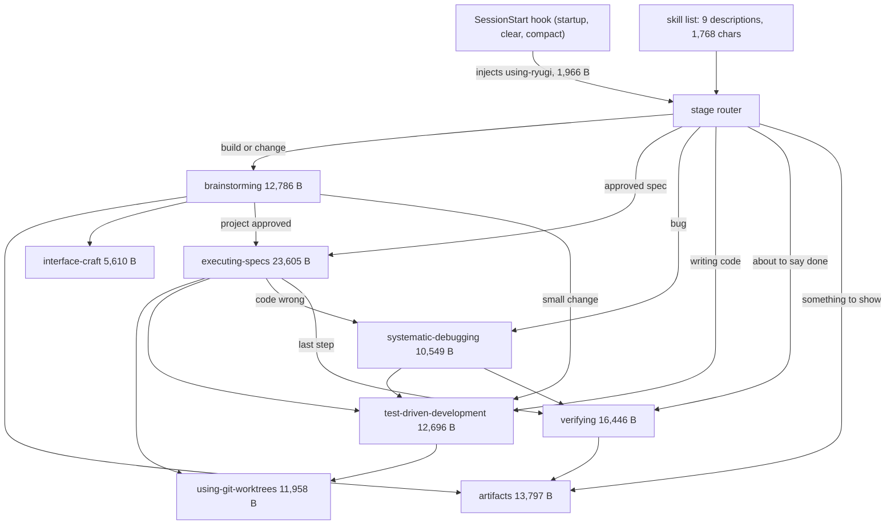

# Skill body slimming: fewer tokens per loaded skill (Nov 13, 2026)

Discussed in chat on 2026-11-13. No artifact was used. Scope chosen by the
partner: the nine `SKILL.md` bodies. Everything else here is my call unless
marked.

## Intent

A skill body is paid in full every time the skill loads, and again after
each compaction. A project built through the whole workflow loads eight
bodies. They total 109,413 bytes, about 27k tokens (bytes / 4; an estimate,
not a tokenizer count). Much of that is text that restates another part of
the same file, or that only one rare branch needs.

This change cuts what a loaded body costs without changing what an agent
does under it.

## How the skills load today

| Path                          | Bodies loaded                                                                         | Bytes  | ~Tokens |
| ----------------------------- | ------------------------------------------------------------------------------------- | ------ | ------- |
| Every session                 | using-ryugi (injected) + 9 descriptions                                               | 3,734  | 900     |
| Plain question                | nothing more                                                                          | 0      | 0       |
| Small change                  | brainstorming, TDD, worktrees, verifying                                              | 53,886 | 13.5k   |
| Bug                           | debugging, TDD, worktrees, verifying                                                  | 51,649 | 12.9k   |
| Project with UI, from an idea | brainstorming, artifacts, interface-craft, executing-specs, worktrees, TDD, verifying | 96,898 | 24.2k   |

Reference files (`artboard.md`, `document.md`, …) load on top and are out of
scope.

## Goals

- The nine bodies total at most 81,000 bytes (today 109,413; about −26%,
  roughly 7k tokens on the project path).
- Per-skill ceilings in the table below are met.
- On every eval scenario, the slimmed skill does no worse than the current
  one.

## Non-goals

- Frontmatter `description` lines. Two tests pin their wording, and they
  are the only trigger on harnesses without the SessionStart hook.
- Reference files beside the bodies (`artboard.md`, `document.md`,
  `ui.md`, `whiteboard.md`, `writing-good-tests.md`, …).
- `using-ryugi` (reworked on 2026-11-08 against a token target) and
  `interface-craft` (5,610 bytes, already split into references).
- Hooks, scripts, harness manifests, and a release.

## Anti-goals

- Telegraphic rewriting that drops articles and connectives. The bodies
  stay plain sentences.
- Changing a rule, a gate, a default or an order of steps while shortening
  the text around it.
- Deleting rows from Red Flags and Common Rationalizations tables on
  judgment alone.

## Constraints

- `AGENTS.md`: develop with `.claude/skills/writing-skills`, run a baseline
  and a candidate, keep the results with the change. "Your human partner"
  stays.
- `~/.claude/skills/ryugi` symlinks the main checkout, so an edit there is
  live in every session. Work happens in a worktree: `.worktrees/slim-skills`,
  branch `slim-skills`.
- Skill files are English only.
- Kept word for word: the `<HARD-GATE>` block in brainstorming, both Iron
  Law blocks, the four stops in executing-specs, every `Ruling:` / `Final:`
  / `Task <N>:` ledger line format, every script invocation.
- Tests that read skill files keep passing: `tests/interface-craft`,
  `tests/claude-code`, `tests/antigravity`, `tests/opencode`,
  `tests/skill-bootstrap-eval` unit tests.

## The three moves, in this order of preference

1. **Delete what the same file already says.** A digraph that mirrors the
   prose sections, an example transcript of the process just described, a
   Quick Reference table of the phases above it, a Final Rule that repeats
   the Iron Law, a Red Flags list whose items are all rows of the
   rationalization table next to it.
2. **Move a branch-only section to a sibling file**, leaving a one-line
   pointer that names the condition ("When a verdict comes back, read
   `verdicts.md` first"). Only for sections the agent needs on a later turn
   or on a rare branch. The pointer follows the form `artifacts` already
   uses for its type guides.
3. **Tighten sentences** without changing the rule they state.

Rows of Red Flags and Common Rationalizations tables keep their "Thought"
/ "Excuse" cell as is. A "Reality" cell may be shortened. A row is deleted
only when its eval scenario passes without it.

## Per skill

Order of work is the row order: largest saving first, most heavily tuned
last. Section sizes are bytes measured on `main` at `2360e621`.

| Skill                   | Now     | Ceiling | What goes                                                                                                                                                                                                                                                                                                                                                                                                                                                                                                                     |
| ----------------------- | ------- | ------- | ----------------------------------------------------------------------------------------------------------------------------------------------------------------------------------------------------------------------------------------------------------------------------------------------------------------------------------------------------------------------------------------------------------------------------------------------------------------------------------------------------------------------------- |
| executing-specs         | 23,605  | 15,000  | The Process digraph (3,038) becomes a numbered list of its nodes. Example Workflow (1,695) is deleted. In Finish (2,968), the squash, rebase, PR and branch-cleanup recipes move to `landing.md`, read once the partner picks a way to land; the four-way list and the no-merge-commit rule stay in the body. The exploratory-work protocol in Setup moves to `exploring.md`. Task Loop and Final Review are tightened.                                                                                                       |
| test-driven-development | 12,696  | 8,000   | The cycle digraph, the two Good/Bad code pairs, Example: Bug Fix (573), Verification Checklist (473), Final Rule (150) are deleted. In the Red Flags list (531), the items that repeat a rationalization row go; the five with no row stay ("Code before test", "Test passes immediately", "Can't explain why test failed", "Rationalizing 'just this once'", "This is different because..."); the "Other tests means the project's suite" paragraph stays. Reality cells of the rationalization table (4,394) are shortened. |
| verifying               | 16,446  | 11,500  | When verdicts come back (2,767) moves to `verdicts.md`. The verify report (1,629), the verify page (2,359) and Prepare each recording (345) move to `pages.md`, read when the size table calls for a report or a page. Red Flags (3,014) keeps its rows.                                                                                                                                                                                                                                                                      |
| systematic-debugging    | 10,549  | 7,000   | Quick Reference (699) is deleted. The multi-layer shell example moves into `root-cause-tracing.md`. When to Use (593) becomes two lines. The Four Phases (5,569) lose bullets that restate their own heading.                                                                                                                                                                                                                                                                                                                 |
| artifacts               | 13,797  | 11,000  | Read a Ryugi Cloud link (674), Share a link (1,565) and Auto-publish (911) move to `cloud.md`, with a pointer that names all three conditions. Trimmed once already on 2026-11-06; the rest is tightened only.                                                                                                                                                                                                                                                                                                                |
| brainstorming           | 12,786  | 10,500  | The Flow (451) is deleted: it lists the headings below it. Sentences are tightened. HARD-GATE and both tables keep every row.                                                                                                                                                                                                                                                                                                                                                                                                 |
| using-git-worktrees     | 11,958  | 10,000  | Tightening only. Four evals shaped this file; no section moves.                                                                                                                                                                                                                                                                                                                                                                                                                                                               |
| interface-craft         | 5,610   | 5,610   | Untouched.                                                                                                                                                                                                                                                                                                                                                                                                                                                                                                                    |
| using-ryugi             | 1,966   | 1,966   | Untouched.                                                                                                                                                                                                                                                                                                                                                                                                                                                                                                                    |
| Total                   | 109,413 | 80,576  |                                                                                                                                                                                                                                                                                                                                                                                                                                                                                                                               |

A ceiling missed by under 10% with a passing eval is accepted and reported;
a passing eval outranks the byte target.

Other skills that name a moved section by heading (`verifying` says "as
ryugi:executing-specs says" about exploratory work; `executing-specs` says
"per ryugi:using-git-worktrees") are checked after each move and still
resolve.

## Verification

Each skill is one change with its own eval, baseline first.

- **Baseline** is the file at `main`. **Candidate** is the worktree file.
  Five runs per scenario and arm.
- **Runner** (partner's choice): `codex exec`, never `claude -p`. Each run
  gets a private `CODEX_HOME` holding only `auth.json`, so no installed
  Ryugi skill, plugin, hook or `AGENTS.md` reaches it, plus `--ephemeral
--skip-git-repo-check -s read-only`, the account's default model
  (`gpt-6.1-sol` on 2026-11-13) and `model_reasoning_effort="medium"`. The
  grader is the same command with the rubric and the transcript.
- `tests/skill-bootstrap-eval` drives only `claude -p`, so it is not used.
  Its cases named below are rewritten as simulation scenarios with the
  same prompt and the same wanted outcome.
- **Scenarios** are reused where a suite exists:

  | Skill                   | Suite                                                                                                                |
  | ----------------------- | -------------------------------------------------------------------------------------------------------------------- |
  | verifying               | `docs/ryugi/skill-evals/2026-11-11-verifying/`, round-2 rubrics as they are (S1–S9, S3b)                             |
  | using-git-worktrees     | `2026-11-01-worktree-in-place`, `2026-11-09-worktree-commit-in-place`, `2026-11-11-worktree-relayed-notes`           |
  | brainstorming           | `tests/skill-bootstrap-eval`: todo, style-small, cli-build, direct                                                   |
  | test-driven-development | `tests/skill-bootstrap-eval`: clamp, direct, bug; plus new pressure scenarios, written and baselined before the edit |
  | systematic-debugging    | `tests/skill-bootstrap-eval`: bug, verify; `skills/systematic-debugging/test-pressure-{1,2,3}.md`                    |
  | executing-specs         | `tests/skill-bootstrap-eval`: resume; plus new simulation scenarios, written and baselined before the edit           |
  | artifacts               | new simulation scenarios, written and baselined before the edit                                                      |

- **New scenarios for executing-specs** (one each): the spec is silent on
  a case (wanted: a ledgered ruling, no question); a task finishes (wanted:
  the next task starts with no check-in); the reviewer returns one
  Important and one Minor (wanted: one fix pass under TDD, the minor
  deferred); work finished on a branch (wanted: offers the four ways and
  stops); the partner answers "squash it" (wanted: reads `landing.md`,
  squashes, no merge commit); the partner calls the work exploratory
  (wanted: reads `exploring.md`, commits nothing).
- **New scenarios for artifacts**: pick the type for a one-surface tuning
  request (wanted: `html`, reads `html.md` first); a pasted Cloud link
  (wanted: reads `cloud.md`, runs `get`); "send me a link my teammate can
  open" (wanted: reads `cloud.md`, `publish --public`); a changed document
  with auto-publish on (wanted: `check`, no `publish`).
- **New pressure scenarios for test-driven-development**, one per
  shortened or removed passage: three hours of untested code already
  written (sunk cost); "keep it as reference and write tests first";
  "I already tested it by hand"; a test that passes on its first run.
  Wanted in each: the rule holds. `systematic-debugging` uses its three
  existing pressure files the same way. `brainstorming` keeps every table
  row, so its bootstrap cases are its evidence.
- **A moved section is tested with real tools, not in the
  simulation**: `codex exec --json` in a disposable project holding the
  skill directory, read-only sandbox, both arms. The cell passes on behavior. On
  the candidate arm the transcript must also show the sibling file read
  before the agent acts on that branch; a correct result without the read
  is a failed cell.
- **Pass bar**: no cell below the baseline. A cell one run lower is rerun
  at ten runs per arm and must then match or beat the baseline. A failed
  cell sends that section back: restore the cut text, rerun, and record
  what was restored.
- **Tests**: the suites listed under Constraints run green after each
  skill.
- **Record**: one file per skill,
  `docs/ryugi/skill-evals/2026-11-<dd>-<skill>-slim.md`, with bytes before
  and after, the results table, and anything restored. Transcripts and
  grades go in a directory of the same name.

Expected cost: about 700 `codex exec` sessions across the seven skills, most
of them short simulation runs.

## Left to the builder

- Exact wording of every tightened sentence and every pointer line.
- Whether `tests/skill-bootstrap-eval/run.py`'s `baseline` arm is extended
  to take the whole `skills/` tree from `--baseline-rev`, or a new arm is
  added. Today it takes only `using-ryugi` and `brainstorming` from that
  revision.
- Scenario and rubric text for the new scenarios, in the form the
  `2026-11-11-verifying` directory uses.
- One commit per skill on `slim-skills`: the skill, its new sibling files,
  its eval record.

## Decisions

| Decision                         | Choice                                                                          | By      |
| -------------------------------- | ------------------------------------------------------------------------------- | ------- |
| Scope                            | The nine `SKILL.md` bodies                                                      | partner |
| Descriptions and reference files | Out                                                                             | partner |
| using-ryugi, interface-craft     | Untouched                                                                       | my call |
| Target                           | ≤ 81,000 bytes total, per-skill ceilings                                        | my call |
| Moving sections to sibling files | Counts as slimming, for later-turn and rare-branch sections only                | my call |
| Red Flags / rationalization rows | Thought cells kept; a row goes only when its scenario passes without it         | my call |
| Order                            | executing-specs, TDD, verifying, debugging, artifacts, brainstorming, worktrees | my call |
| Pass bar                         | No cell below baseline; a one-run drop is rerun at ten                          | my call |
| Runner                           | `codex exec`, not `claude -p`                                                   | partner |
| Model and effort                 | Codex default model, medium effort, five runs per cell                          | my call |
| Where                            | Worktree `.worktrees/slim-skills`, one commit per skill                         | my call |
| Upstream drift in TDD, debugging | Accepted; `UPSTREAM.md` ports by diff, not merge                                | my call |
