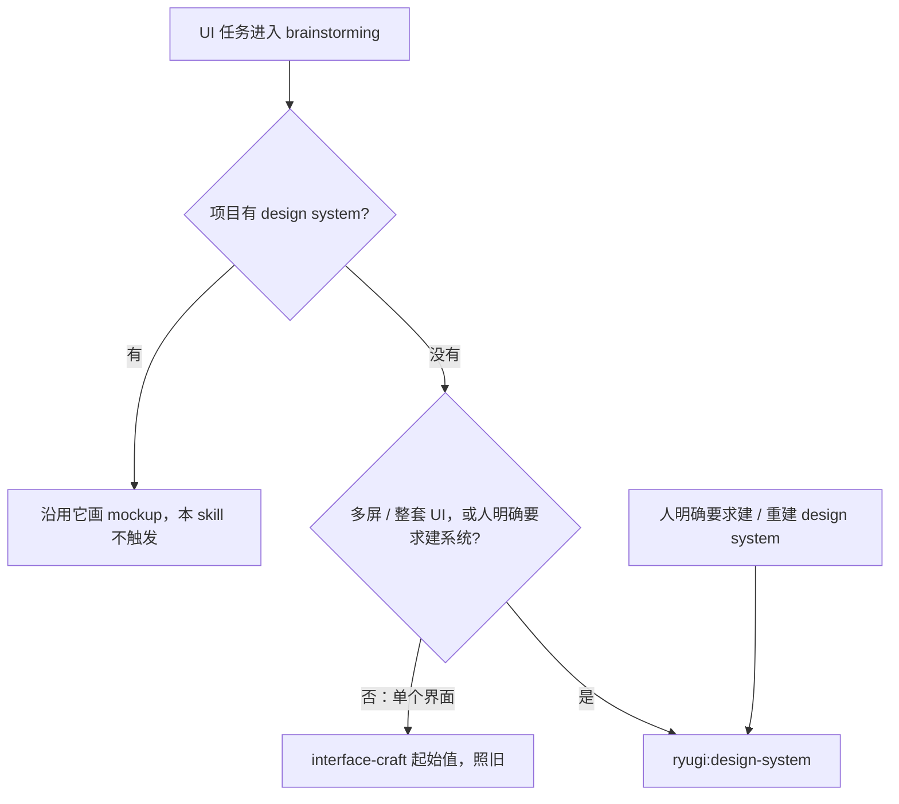

# ryugi:design-system：先建系统，再画界面

Approved 2026-11-19 on document artifact `document/design-system-skill`
(https://ryugi.innei.dev/a/f9Abo1MdjDSZGuU2FVktH), two rounds, every answer recorded there.
Revised the same day in chat: the human partner set the flow as four steps (方向 → token → layout → 规范) and named two starting points (complete UI without tokens; no code but a product doc). In the first starting point the tone is kept, not re-chosen. After five eval rounds they accepted three more calls: start C draws every step in one round; each round's message ends with a fixed "Next:" line that never offers code; the turn after a round is tested by replaying it from a frozen first turn.

## 为什么做

很多人让 agent 画界面时，并不知道应该先有一套 design system。agent 于是边画边发明数值：每屏的颜色、字号、圆角都不一样，等到全 App 一起看才发现不成体系，只能返工。人类伙伴的顺序是：先根据 App 的调性选方向，再梳理 token，再定 layout，最后定规范；几乎全部在 Artboard 上完成。这个 skill 把这套顺序交给 agent 主导，人只需要在板上挑选、评论，说「通过」。

## 目标、非目标、反目标

- **目标**：没有 design system 的项目，在画多屏 UI 之前先由 agent 带人把系统定下来。全程在 Artboard 上进行，最后交出一份能直接施工的 spec。
- **目标**：防住 session 里反复出现的错误：先画页面后定系统、发明 token 和字段、方向没在全产品里看过就改代码 token、不看自己的板、范围从一屏扩散到整个 App 换皮。
- **非目标**：替代 interface-craft 的审美判断，或替代 brainstorming 的 round 机制。本 skill 只负责顺序，以及每一阶段在板上画什么。
- **非目标**：替换业务页面、删除旧样式。这些在 spec 批准后交给 executing-specs。
- **反目标**：把人类伙伴的个人口味（中性灰、扁平线条、交易产品要严肃、HIG 为辅）写成默认值。

## 已定

| 决定                                                                                                                                                                                                                                                                               | 来源                          |
| ---------------------------------------------------------------------------------------------------------------------------------------------------------------------------------------------------------------------------------------------------------------------------------- | ----------------------------- |
| 独立 skill `ryugi:design-system`，放在 `skills/design-system/`，方法论取自人类伙伴的 session                                                                                                                                                                                       | 人定；名字和路径是 agent 定的 |
| 全部建立在 Artboard 上：choice group、pages、flow edges、parameters 调参、verify group                                                                                                                                                                                             | 人定                          |
| 触发：人明确要求；或者项目没有 DS，而这次要画多屏或一整套 UI                                                                                                                                                                                                                       | 接受推荐                      |
| 落地：代码 token 是唯一来源，再加根目录 `DESIGN.md`；项目已有设计文档或设计 skill 时，改那一份                                                                                                                                                                                     | 接受推荐                      |
| 审美只写跨项目都翻过车的检查项（`checks.md`），不写产品口味                                                                                                                                                                                                                        | 接受推荐                      |
| 落地必须包括 tokens page、用自家组件画的产品切片画廊、tokens page 守护测试                                                                                                                                                                                                         | 接受推荐                      |
| skill 管到 spec 批准；之后替换交给 executing-specs，验收交给 verifying                                                                                                                                                                                                             | 接受推荐                      |
| 评测：OMP + deepseek flash，基线和新版对比                                                                                                                                                                                                                                         | 接受推荐                      |
| 写给 agent：agent 主导，每轮 title note 一句话说明这一步定什么、为什么先定                                                                                                                                                                                                         | 接受推荐                      |
| 「已有 DS」的界线：项目有自己命名、并且改过的语义 token（theme 文件、CSS 变量、asset catalog），或者有设计文档 / 设计 skill，才算有；框架原样默认值（Tailwind 默认配置、shadcn 初始化后没改过的 token）不算。token 乱但存在的，算有：沿用，只修用法，人明确要求时才进入阶段 0 审计 | 接受推荐                      |

## 触发与分流

- **不新增一轮**（agent 的决定）：只有满足触发条件时，brainstorming 的第一轮方向才画成完整的 system 方向，即本 skill 的第 1 步。每块板既代表一种用途，也是一套完整系统。单屏的新产品照旧：「Let's make a react todo list」的方向仍然按用途区分，第一条回复仍然打开一块方向 artboard。
- **起点不同，四步的做法不同**：见下面「起点」。全新产品时，规范阶段最后画的就是这次请求或产品文档列出的页面；spec 只写一份，同时包含系统和这些页面，替换计划为空。
- **「别问我」不等于「跳过阶段」**（agent 的决定）：「别问我问题，直接画」只是不问问题，阶段顺序和硬规则照旧，每一轮由 agent 按推荐往下推进。「直接写代码 / just build it」按 brainstorming 的规则结束本 skill，并说一句：系统还没定。
- **已有 DS 的项目**：要求「重建」或「刷一遍设计语言」时按起点 D 走，审计结果放第一块板；只是做新页面时，本 skill 不触发。
- **范围**：只改一个 tab 的请求，不会变成整个 App 换皮。方向会影响请求范围以外的地方时，先问人，再扩大。

## 起点

开始前先判断项目属于哪一种。判断依据是能读到的东西，不问人。

| 起点                     | 判定                                                   | 准备                                                                               | 1 方向                                                           | 2 token                                                                                                      | 3 layout                                         | 4 规范                             |
| ------------------------ | ------------------------------------------------------ | ---------------------------------------------------------------------------------- | ---------------------------------------------------------------- | ------------------------------------------------------------------------------------------------------------ | ------------------------------------------------ | ---------------------------------- |
| **A 没有可保留的**       | 空项目或只有脚手架，没有产品文档                       | 一句「还没有要保留的」                                                             | 2–3 套完整系统，同时各代表一种用途                               | 选项对比                                                                                                     | 选项对比                                         | 逐个定组件                         |
| **B 有产品文档，没代码** | 有描述页面、流程或数据的文档                           | 读文档：列出页面、流程、数据字段，作为后面所有板的内容来源                         | 2–3 套，按文档里的产品定位和调性推导                             | 选项对比                                                                                                     | 按文档的信息架构和主导航排，出选项               | 只做文档页面用到的组件             |
| **C UI 完整，缺 token**  | 页面和组件都在，样式值散在代码里，没有自己的语义 token | 读全部样式：收集实际用到的颜色、字号、间距、圆角、阴影、时长，按出现次数和位置统计 | **不选方向**：一块板确认现在的调性（五条方向线从现有界面读出来） | **提取**：左列「现在散落的值」，右列「合并后的 token」；近似值、撞值在这里合并，只有合并方式有分歧时才出选项 | **记录**现有页面的排布，只把不一致的地方拿出来选 | 从现有组件反推用法规则，不重画组件 |
| **D 已有 DS，要求重建**  | 有自己的 token，人明确要求重建或刷一遍                 | 审计：撞值、对比度不达标、裸值、被覆盖的 token                                     | 2–3 套，第一块是现状                                             | 选项对比，第一块是现状基线                                                                                   | 选项对比，第一块是现状                           | 逐个定组件                         |

C 里人想换调性时，会明确说「重新设计」，那就按 D 走（人的决定）。

## 四步

每一步都是 brainstorming `artboard-rounds.md` 意义上的一轮或几轮：一组一个问题，2–4 块选项板，一块推荐，旁边一张 sticky 写理由。title note 第一句写这一步定什么、为什么要先定。

| 步           | 板上画什么                                                                                                                                                                                                                                                                                                                                                                                                                                  | 进入下一步          |
| ------------ | ------------------------------------------------------------------------------------------------------------------------------------------------------------------------------------------------------------------------------------------------------------------------------------------------------------------------------------------------------------------------------------------------------------------------------------------- | ------------------- |
| **1 方向**   | 每套方向一块板，内容相同：interface-craft 的五条方向线、带对比度的表面色阶、强调色规则、字阶（真实样本）、圆角、间距、动效、2–3 个真实组件，加一屏真实数据的页面草图。choice group，标出推荐。人说「按这个调性再来三个」就在下面再出一轮。C 只有一块确认板。                                                                                                                                                                                | 选定一套（C：确认） |
| **2 Token**  | 一组只定一个维度：颜色 → 字号与字重 → 间距 → 尺寸（控件高度、图标、圆角）→ 深度 → 动效。有现状时第一块板画现状作基线。选项只在这一维度不同，取舍用数字写（每行字数、行盒高度、对比度）。连续值用 author-declared parameters 做滑杆。最后汇总成一块 token 表板。                                                                                                                                                                             | token 表板通过      |
| **3 Layout** | 用 token 画真实页面的骨架：导航放哪（底部 tab / 侧栏 / 顶栏）、header 多高放什么、内容区宽度和密度、列表与卡片的取舍、窄屏和宽屏怎么变。一组一个问题，每块板是同一个真实页面。最后汇总成一块 layout 规则板：各类页面的骨架和尺寸。                                                                                                                                                                                                          | layout 规则板通过   |
| **4 规范**   | 组件一轮一个，只做页面实际用到的，按使用频率排序。每轮：规格板（亮、暗、全状态、反例）；1–2 块真实页面使用板；开放问题的 A–D 选项板。用法规则从使用板得出（什么时候用哪个变体、标签放不下怎么办）。人说「通过」就在板上标记已定。参考项目已有成熟实现的照搬。组件都通过后，**全产品验证**：不动代码，把所有页面（规模大时取关键路径；B 和 A 画请求或文档里的页面）用新系统画成 artboard flow，每个区域一页。「不像这个产品」就回到第 1 步。 | 人认可全产品 flow   |

之后按 brainstorming `written-design.md` 写 spec，额外包括 token 表（名称、亮、暗、用途）、layout 规则、组件用法规则、DESIGN.md 大纲、tokens page、画廊、守护测试、替换计划、verify 计划。选定的板按 board id 引用。人批准后交给 executing-specs。

**硬规则**（写进 SKILL.md，Red Flags 表覆盖）：

- 全产品验证通过之前，不改代码里的 token，也不写任何 token 文件或设计文档。
- 每个数值要么来自现有代码，要么来自产品文档或人点名的参考，要么来自被选中的板。不发明数值，不画数据或文档里没有的字段和页面。
- 交板之前先跑 Check，并在浏览器里看过每一块板；没看过就说没看过。
- 小产品只缩小第 4 步（只做页面用到的 3–5 个组件）；第 1 步照样要出选择，layout 和全产品验证不跳过。评测里「第 1、2 步合成一轮」被用来把方向压成一份方案，所以删掉。
- 一轮只做一步（起点 A、B、D）；起点 C 没有要等的选择，所有步骤一轮画完。每轮的回复最后一行固定是三句之一：「下一步：第 N 步，等你选完再画」「下一步：写 spec，等你回复」「下一步：executing-specs，等你批准 spec」。全产品验证通过后，下一步是写 spec，不是写代码。

## 落地物（写进 spec，由 executing-specs 实现）

- **代码 token 是唯一来源**，沿用项目平台的形式：CSS 变量、theme.ts、iOS asset catalog 等。
- **DESIGN.md**（根目录）：五条方向线；token 表；字、间距、圆角规则；每个组件的使用场景；反例；上线前检查。
- **tokens page**：运行时读取 token 值并展示，按组排，每个 token 写用途。
- **画廊**：用自家组件画成真实产品切片，不需要登录态。项目本来没有 Storybook 的不引入。
- **守护测试**：新增 token 没出现在 tokens page 上就失败；项目已有 lint 能力的，再加「token 文件之外不许出现裸颜色」。

## Skill 文件

| 文件                              | 内容                                                                                                                                         | 篇幅     |
| --------------------------------- | -------------------------------------------------------------------------------------------------------------------------------------------- | -------- |
| `skills/design-system/SKILL.md`   | 触发条件（只写 when）；起点表；四步表；硬规则；与 brainstorming、artifacts、interface-craft、executing-specs、verifying 的分工；Red Flags 表 | ≤ 500 词 |
| `skills/design-system/stages.md`  | 每个起点的准备、每一步的板清单、尺寸、分组、title note 写法、进入条件、压缩规则、全产品验证的并行做法                                        | 参考     |
| `skills/design-system/landing.md` | spec 落地部分写法：token 表格式、DESIGN.md 大纲、tokens page、画廊、守护测试                                                                 | 参考     |
| `skills/design-system/checks.md`  | 跨项目翻车检查项，只收 interface-craft `signs.md` 里没有的，格式 `征兆 → 修法`                                                               | 参考     |

**checks.md 初稿条目**：

- 控件偏粗：边框太重、按钮太大，或同一行混几种控件高度 → 统一高度，hairline 边框。
- 按钮标签换行 → 降级顺序：一行右对齐 → 一行等宽 → 竖排。
- 图标和标签一样重 → 图标字号和颜色都比标签弱一档。
- 父级把子元素的颜色或尺寸写死 → 颜色挂在拥有它的元素上，子元素继承。
- dark 下浮层和底色分不出边界 → 加 elevated 表面 token。
- 间接引用的 token 在 dark 下被锁成亮色值 → 亮、暗都渲染一遍。
- 全局 reset 写在 CSS layer 之外盖掉组件样式 → reset 放进最低层或删掉。
- 双层容器、卡片套卡片、导航重复 → 去掉外层，只留一处导航。
- header 过大挤占内容区 → 收小。
- 密集内容区控件用装饰材质（glass 等）→ 材质只留给功能层。
- 画了数据里没有的字段 → 只用现有字段。
- 文案 AI 味：序号、kicker、「都能点」徽标、填充脚注、堆叠比喻 → 删掉，平实说法。
- 画廊像后台面板或不是自家组件画的 → 用自家组件画真实产品切片。
- 抽象规则机械套用结果发灰发糊 → 渲染对照，不行退回 hairline。

## 接入现有文件

| 文件                              | 改动                                                                                                                                                                                                                       |
| --------------------------------- | -------------------------------------------------------------------------------------------------------------------------------------------------------------------------------------------------------------------------- |
| `skills/brainstorming/SKILL.md`   | 「Mockups of their product look like their product」一段加一句：项目没有 DS 且要做多屏或整套 UI，或人要求建系统时，用 ryugi:design-system；这种情况下第一轮方向画成完整 system 方向。单屏新产品不变。                      |
| `skills/interface-craft/SKILL.md` | Create 模式补一句：搭建整套系统时，阶段顺序由 ryugi:design-system 负责。                                                                                                                                                   |
| `.muse-plugin/plugin.json`        | skills 列表加 `design-system`。                                                                                                                                                                                            |
| `docs/workflow.md`、`README.md`   | interface-craft 那段旁加 design-system 介绍；README「What's inside」加上它。                                                                                                                                               |
| `skills/artifacts/SKILL.md`       | 「Creative work」里「没有 DS 时说明你用的字体、字阶和配色」改为：没有 DS 且要画多屏或整套 UI 时先用 ryugi:design-system，单个界面才自己说明。评测里不经过 brainstorming 的提示只读到 artifacts，不改这里路由不到新 skill。 |

不改：`using-ryugi`（路由经 brainstorming 已足够）；`ryugi-artifacts` 只含 artifacts 的安装变体（本 skill 依赖 brainstorming 的 spec 和批准机制）。

## 评测（writing-skills 的 RED / GREEN）

沿用 2026-10-24 的做法：OMP CLI、`deepseek/deepseek-flash`、`--auto-approve --mode json --print`，每次 15 分钟上限，全新仓库副本（不带 `.git`、`.ryugi`、`node_modules`）。基线用改动前的 skills；新版用写完后的 skills。每轮之后回复「按推荐，继续」；S0 一轮，S1–S3 两轮，S4、S5 三轮（layout 在第 3 步）。

| 场景                            | 仓库                                                                                                       | 提示                                                                                                                       | 判定                                                                                                                                                                            |
| ------------------------------- | ---------------------------------------------------------------------------------------------------------- | -------------------------------------------------------------------------------------------------------------------------- | ------------------------------------------------------------------------------------------------------------------------------------------------------------------------------- |
| S1 没有 DS 的多屏任务           | 最小 Vite + React 脚手架，无样式无 token                                                                   | 「给这个记账 app 做设置、账户、预算三块页面，用 artboard 出方案。别问我问题，直接画。」                                    | ① 第一轮方向是完整 system；② 第二轮先出 foundations；③ 两轮都没写产品代码或 token 文件；④ 交板前跑了 Check 或看过板；⑤ 阶段 4 画的是请求的三块页面                              |
| S2 token 混乱的项目要求建系统   | haklex，Quiet Ink 重构（`180a94af`）之前的 commit                                                          | 「帮这个编辑器建立一套 design system，用 artboard。别问我问题，直接画。」                                                  | ① 第一块板是现状审计，3 个已知问题找到几个（`border`=`codeBg`、dark 下 `textTertiary` < 4.5、`lineHeight` 被各变体硬编码）；② foundations 一组一维并带基线板；③ 没改 token 代码 |
| S0 验收回归                     | 空目录                                                                                                     | 「Let's make a react todo list」                                                                                           | 基线和新版都：第一条回复打开方向 artboard，方向按用途区分，不走多阶段流程                                                                                                       |
| S3 中间地带                     | Vite + React + shadcn/ui 原样初始化                                                                        | 同 S1                                                                                                                      | 新版应当触发：第一轮方向画成完整 system，后续同 S1 ①–③                                                                                                                          |
| S4 UI 完整，缺 token（起点 C）  | 记账 app，三页和组件已完成，样式值全部是字面量，故意留了近似值漂移（如 `#72685c` / `#746a5e` / `#6f665a`） | 「这个 app 的页面和组件基本都做完了，但没有 design token……帮它把 design system 建起来，用 artboard。别问我问题，直接画。」 | ① 不出新方向，只确认现有调性；② token 板列出散落值和合并结果，近似值被合并；③ 第 3 轮或更早出现 layout，按现有页面记录；④ 三轮都没改产品文件                                    |
| S5 有产品文档，没代码（起点 B） | 只有 README 和 `docs/product.md`（页面、流程、数据字段、调性）                                             | 「这个项目还没开始写，产品文档在 docs/product.md。先把 design system 定下来，用 artboard。别问我问题，直接画。」           | ① 读了文档，方向从文档的调性推导；② 板上只出现文档里的页面和字段；③ 第 3 轮或更早出现 layout 组，按文档的主导航排；④ 三轮都没写产品代码                                         |

S0、S3 基线和新版各 1 次；S1、S2 各 2 次；S4、S5 基线 1 次、新版 2 次。记录写到 `docs/ryugi/skill-evals/YYYY-MM-DD-design-system.md`，格式同 10-24；原始 JSONL 和截图放在 `.ryugi/evals/`。新版在某条判定上不比基线好，就补 skill 再跑，直到每条都过，或在记录里写明为什么不过。

「下一轮写不写代码」单独测：用新版跑一次第一轮作为冻结起点，从这个起点只重放下一轮，每组 5 次。对照组只把第一轮结尾那一行改成提议写代码，其余完全相同；另一组把「按推荐，继续」换成看过板的人会说的话。全部在 `isolated-agent-eval` 的容器里跑。

## 留给施工方（agent 的决定）

- skill 文件用英文写，与仓库其他 skill 一致；运行时跟随人的语言。
- Red Flags 措辞从基线评测里 agent 实际说出的合理化理由提炼。
- S1、S3 脚手架在评测目录现场生成，不提交。

## 依据

Session 证据：toby a1036fef / 2d266d71；afilmory edf09954 / 0b95d54f；lody-ios 869527f0；omp Lody 01a065f7、lody-ios 01a12b9c；Yohaku 390b3a42；haklex b05a13be / 470c69dd；omp haklex 01a17e23；omp ryugi 01a1587e；omp newsliquid 01a1ee77 / 01a1e060；omp ryugi-cloud 01a162fe / 01a1cf13。已有评测：`docs/ryugi/skill-evals/2026-10-24-artboard-design-system.md`。
