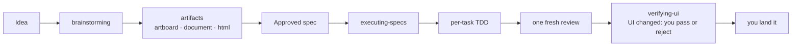

# The workflow

Your agent doesn't jump into code. It asks what you're really trying to do, pulls a spec out of the conversation, and plays it back in chunks short enough to read.

When seeing beats reading, it opens a local artifact: a document for architecture, reviews and proposals; an artboard to compare mockups across several dimensions; or one HTML page — a test bench with sliders, a focused design study — that updates live as the agent rewrites it. HTML artifacts can use a bundled Web Component kit (Lobe UI buttons, inputs, sliders, switches, cards) so a test bench looks like the product and keeps its settings across rewrites. Everything runs locally; no subscription.

After you sign off, it builds inline from the spec unless you say "just code it": your agent slices the spec into tasks, proves each with true red/green TDD, keeps a ledger of every judgment call across compaction, gets one fresh review of the whole branch, then reports how to land it — squash (default), rebase, PR, or keep. Never a merge commit.

Two-hour autonomous stretches without "should I continue?" are normal. Because the skills trigger automatically, there is nothing to invoke.

## The skills

1. **brainstorming** — activates before building anything. Draws out what you actually want and why, then plays its understanding back for correction. Questions start in chat, one at a time; once the work spans modules or reaches the architecture, or you ask for a design up front, they move into a document you answer a round at a time. What you'll see is designed on the Artboard, a round of options at a time. Small changes get agreed in chat; projects get a design document a builder could build from.
2. **executing-specs** — activates when you approve the spec and choose inline. Slices the spec into tasks, implements each under TDD with a ledger that survives compaction, records every judgment call as a ruling, gets one fresh review, then stops and reports.
3. **test-driven-development** — activates during implementation. RED-GREEN-REFACTOR: failing test, watch it fail, minimal code, watch it pass, commit.
4. **systematic-debugging** — activates on a bug or unexpected behavior. Root cause before fixes.
5. **verifying-ui** — activates when built work or a bug fix changes what you see. Puts real screenshots and recordings next to the approved design (or before next to after) on the Artboard; you pass or reject each group in the browser, and rejected ones come back fixed until all pass.
6. **using-git-worktrees** — activates when executing-specs or test-driven-development hands off before the first implementation edit, to pick where the work happens. Follows your stated preference. Without one, it works in place beside other agents and opens a worktree without asking only when the work moves HEAD (branch switch, rebase, bisect) or would collide with another agent: a file with their uncommitted edits, a path they are exploring, or a dependency, lockfile, repo-wide format or codegen change while they are present. It asks only when HEAD is on someone else's branch.
7. **artifacts** — activates when something is clearer to look at than to read, in brainstorming or anywhere else. Artboards, live HTML pages, and a bundled Web Component kit, each at its own local link.

**Your project's own skills come first at their step** — a design system before mockups, a verify skill before reporting, a ship skill for merging. Ryugi sets the process; your project carries its domain.

## What's inside

- **Process** — `brainstorming`, `artifacts`, `executing-specs`, `verifying-ui`
- **Discipline** — `test-driven-development`, `systematic-debugging`
- **Workspace** — `using-git-worktrees`
- **Meta** — `using-ryugi` (bootstrap, plus evidence before claims)

`writing-skills` — creating and testing skills — lives at `.claude/skills/writing-skills/` and loads only when you work on Ryugi itself.
