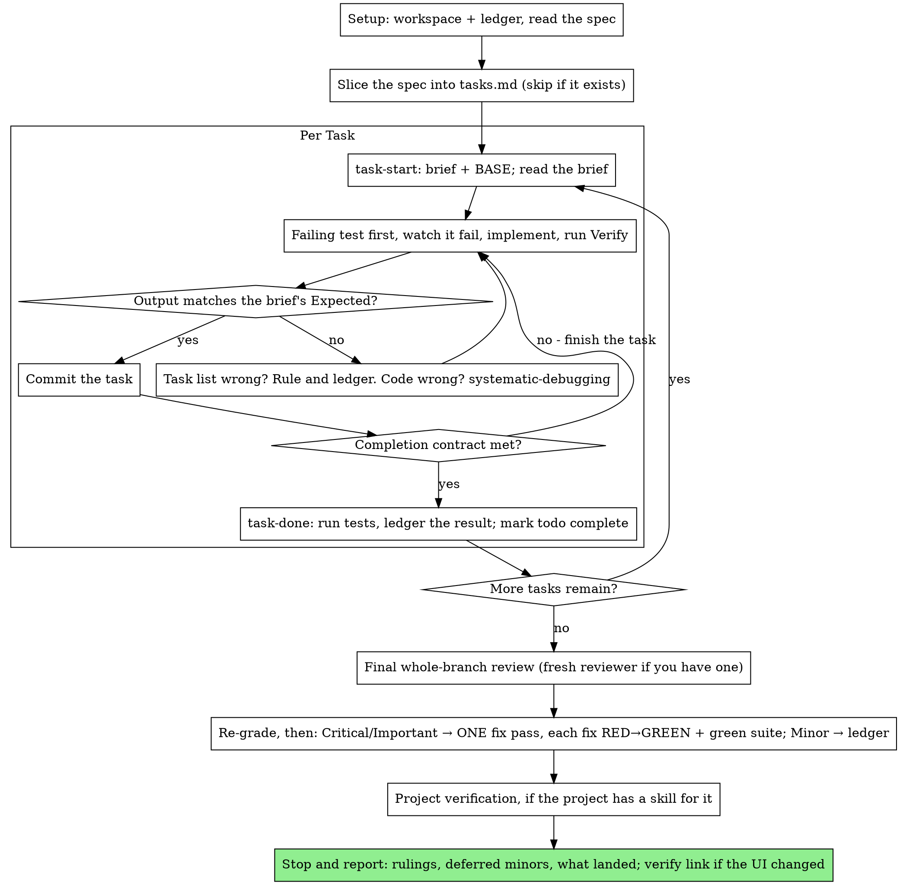

# Executing Specs

Implement an approved spec yourself, task by task, in this session. You
slice the spec into tasks, prove each one with a test you watched fail and
then pass, and get one fresh-context review of the whole branch at the end.

**Core principle:** The spec says what to build; how to slice it is your
call. Slice once, prove every slice, and leave a record that survives your
own forgetting: the ledger is your memory, TDD is the per-task gate, and
the final reviewer is the second pair of eyes.

**Narration:** between tool calls, narrate at most one short line — the
ledger and the tool results carry the record.

**Continuous execution:** Do not pause to check in with your human partner
between tasks. They approved the spec and chose inline execution so they
would not have to answer "should I continue?" after every task. Execute
every task without stopping.

**Rulings, not stalls.** Conflicts, ambiguities, gaps the spec is silent
on — decide them. The spec is the binding authority, your task list is
your reading of it, and your judgment settles what the spec does not
answer. Record every decision in the ledger as
`Ruling: <what you decided> — <why> — <what it costs if wrong>`, and keep
going. Deviating from the spec without a ledgered ruling is a decision
made in secret.

Four things stop you, and only these: an irreversible or destructive
operation; a security-sensitive action; a side effect outside this working
tree that norms say you ask about first (a merge, a push to a shared
branch, a publish); and a spec so broken that every path forward is a
guess. For those, stop and ask.

## When to Use

- Your human partner approved a spec from ryugi:brainstorming and
  chose Inline at the handoff.
- They point you at a design document and ask you to build it.
- An older plan file with `Task N` headings works too: it already is a
  task list, so skip the slicing step.

"Just code it" at the handoff means no spec execution: build the change
under ryugi:test-driven-development and report.

On a spec large enough that its later tasks run on a compacted context,
the ledger is what makes the run recoverable — but the last tasks get the
least of you. Say so to your human partner before starting.

## The Process



## Setup

Work where your human partner's instructions say: on main, on a branch,
or in a worktree. With no stated preference, choose from what the
checkout shows. Other agents may be working in it at the same time;
isolation is per file, not per directory.

Run `git rev-parse --git-dir --git-common-dir`, `git branch --show-current`,
`git status --porcelain` and `cat .ryugi/sdd/*/EXPLORING`, then take the
first row that matches:

| The checkout shows | Where you work |
|---|---|
| `--git-dir` differs from `--git-common-dir` (a linked worktree) | Stay there |
| A file your spec changes has uncommitted edits you did not make | New worktree, without asking |
| An `EXPLORING` file lists a path your spec changes | New worktree, without asking |
| The spec changes state the whole checkout shares: switching branches, rebase, bisect, upgrading dependencies or the lockfile, repo-wide formatting or codegen | New worktree, without asking |
| HEAD is on a branch that is neither the default branch nor one made for this spec | Ask whether to use a worktree |
| Anything else, including uncommitted edits in files your spec does not change | In place, no question |

New worktrees come from ryugi:using-git-worktrees.

**In place**, the checkout is shared:

- Files you did not change belong to someone else: never stage, stash,
  restore, reset or check them out. Stage your own paths by name; never
  `git add -A`, `git add .` or `git commit -a`.
- Your human partner calls the work exploratory: commit nothing until
  they keep it. Once `tasks.md` exists, write `<workspace>/EXPLORING` —
  first line `Exploratory: may be thrown away.`, then every path from the
  tasks' **Files:**, one per line, and add any path you touch later.
  Close each task with `task-done … BASE --uncommitted -- <test command>`
  and review with `review-package SPEC_FILE --exploring`. When they keep
  it, commit the listed paths by name. When they discard it, `git restore`
  the listed paths that exist in HEAD and delete the listed files you
  created, nothing else. Delete `EXPLORING` either way.

Conversation memory does not survive compaction. An executor that loses
its place re-implements tasks whose commits already exist. Track progress
in a ledger file, not only in todos. Harness todos are a live view; the
ledger is the record.

- Each spec owns a workspace: at skill start, run
  `bash scripts/sdd-workspace SPEC_FILE` — it prints the spec's
  git-ignored directory (`<repo-root>/.ryugi/sdd/<spec-basename>/`),
  home to every artifact for THIS spec: task list, ledger, briefs, review
  packages. Another spec's directory is never yours to read or write,
  apart from reading its `EXPLORING` at Setup.
- Check for the ledger at `<workspace>/progress.md`. If its first line
  names your spec file, tasks with a `Task <N>: complete` line are DONE —
  do not redo them; resume at the first task without one. Their commits
  exist in git even when your context no longer remembers making them:
  after compaction, trust the ledger and `git log` over your own
  recollection.
- Create the ledger with its identity as the first line:
  `# SDD ledger — plan: <spec file path>` (the scripts write this form).
- `git clean -fdx` will destroy the workspace (it's git-ignored scratch);
  if that happens, recover from `git log` and the spec.

Read the spec once, end to end.

**REQUIRED SUB-SKILL:** load ryugi:test-driven-development now,
before slicing. It governs every task below.

## Slice the Spec

Before Task 1, write `<workspace>/tasks.md`. If it already exists, this is
a resume: read it, never rewrite it.

Do not show the task list to your human partner for approval. They
approved the spec; the slicing is yours. Record it in the ledger as
`Slicing: <N> tasks — <one line on how you cut it>`.

Each task is a section under a `## Task <N>: <name>` heading — the scripts
find tasks by that heading — with these parts, in order:

- **Goal:** the slice of behavior, with the spec section it comes from.
- **Files:** what it creates or changes.
- **Interfaces:** `Produces:` what later tasks use; `Consumes:` what it
  uses from earlier tasks, by exact name.
- **Failing test:** the test to write first and what it asserts. Work
  with no testable behavior (config, docs, generated code) names a check
  command instead.
- **Verify:** the command for the whole task, and `Expected:` its result.
  For a user-visible change, when the project has its own skill for
  checking the running product (simulator, browser, local test run), name
  it here too.

Cut so that every task ends green and committable, and every `Consumes:`
matches an earlier task's `Produces:` exactly. Where the spec forces two
tasks into conflict, rule on it now with the spec as the authority.

End `tasks.md` with a `## Review Focus` section: the inputs and failure
modes your tests will not exercise. The final reviewer checks each one
deliberately.

Create a todo per task.

## The Task Loop

Everything you print, and every tool result, stays resident in your
context for the rest of the session. Redirect long test output to a file
in the workspace and read its tail; read a brief, not the whole task list.

### 1. Take the task

- Run `bash scripts/task-start SPEC_FILE N`. It prints the brief path and
  BASE (the commit the task's range is cut from) in one call. Read the
  brief for every task, including ones you remember writing: what you
  remember is a summary, the brief has the exact names and tests.
- Mark the task's todo in_progress.

Every tool call is a turn that re-reads your whole context. Bookkeeping
rides along with work — a ledger append in the same call as the commit,
never in a call of its own.

### 2. Do the work

Under ryugi:test-driven-development, loaded at setup: write the
brief's failing test, run it, and watch it fail for the expected reason. A
test that passes before the implementation exists is a finding about the
test. Then write the minimal code, run Verify, read its output, and
compare it against `Expected:`. Three outcomes:

- **Matches.** Commit — exploratory work skips the commit (see Setup).
- **The code is wrong.** Use ryugi:systematic-debugging. Find the
  cause; never patch the symptom to make the output match.
- **The task list is wrong** — a task contradicts the spec, an interface
  from an earlier task doesn't match what this task consumes, a command
  that cannot work. Rule on the smallest change that satisfies the spec,
  ledger it as `Task <N>: Ruling: <finding> — <what you decided and why>`,
  fix the later tasks in `tasks.md` that it touches, and continue.

A task that spans several commits is fine; BASE is what the review range
is cut from, never `HEAD~1`. In place, other agents' commits can land
inside BASE..HEAD: keep the SHA of every commit you make.

### 3. The completion contract

Before a task's ledger line, all of the following are true, with evidence
in this session — not inferred from the diff looking right:

- The brief's failing test exists, you watched it fail, and it now passes.
- The final test run for the task passed — `task-done` is that run, and
  it writes the command and result into the ledger line.
- Verify's output was compared against `Expected:`.
- Every deviation from the brief has a `Ruling:` line in the ledger.

Evidence before claims (see ryugi:using-ryugi) governs the
claim. If any item is missing, the task is not complete: finish it.

### 4. Complete the task

Run `bash scripts/task-done SPEC_FILE N BASE -- <test command>` with the
brief's Verify command. It runs the tests, keeps the full output in the
workspace, prints the tail, and — only if they pass — appends the
completion line to the ledger:

`Task <N>: complete (commits <base7>..<head7>, tests: <command> → <result>)`

In place, list your own commits instead of the range:
`bash scripts/task-done SPEC_FILE N BASE <sha>... -- <test command>`
records `commits <sha7> <sha7>`.

A failing run records nothing; the task is not complete. When it records,
mark the todo complete and take the next task.

## Final Review

Run `bash scripts/review-package SPEC_FILE MERGE_BASE HEAD`
(MERGE_BASE = the commit the work started from, e.g.
`git merge-base main HEAD`) and review from the file it prints. In place,
run `bash scripts/review-package SPEC_FILE --commits <sha>...` with every
SHA from the ledger's `Task <N>: complete` lines, so other agents' commits
stay out of the package. Exploratory work has no commits: run
`bash scripts/review-package SPEC_FILE --exploring`.

**With a subagent tool:** dispatch the reviewer on the most capable
available model — the whole-branch review is a judgment task — using
[code-reviewer.md](code-reviewer.md), with the package path, the spec
path, the `## Review Focus` section of `tasks.md` verbatim, and a pointer
to the ledger's `Ruling:` lines so it can weigh the calls you made.
Specify the model explicitly; an omitted model inherits the session's,
which may not be the most capable. This is the one fresh context the
whole run buys. Do not skip it, and do not replace it with your own read
of the diff.

**Without a subagent tool:** read code-reviewer.md and perform that review
yourself against the package, as a separate pass after the last task's
ledger line. Write `Final review: self-review (no subagent tool)` to the
ledger, and say so in your final message: a self-review by the author is
weaker than a fresh reviewer, and your human partner decides whether that
is enough before merge.

Sort the findings before you act on any of them. The reviewer's severity
labels are advice; the gate is yours. Its "Declined to judge" list is
yours too: every line there is a ruling you make and ledger —
`Final: Ruling: <behavior the reviewer set aside> — <what a reasonable
person using this software gets, and why that stands or why it is now a
finding> — <cost if wrong>`. Re-grade first, by effect: the spec is a
vision document, and a finding's grade is what a reasonable person using
this software gets if it ships, not whether the spec names the input that
triggers it — a reviewer who set a finding at Minor because the spec was
silent has graded the spec, not the effect. Then:

- **Critical and Important** enter the fix pass.
- **Minor** goes to the ledger as `Final: minor (deferred): <one-liner>`
  and to your final message under "Deferred minors". Minors never enter
  the fix pass, and never become rulings — a ruling is a decision about a
  conflict, not a note that you declined a polish suggestion.

Fix the Critical and Important findings yourself in ONE pass. Each fix is
verified by TDD, not by a second reviewer: write the test that reproduces
the finding, watch it fail, make it pass, then run the whole suite. Record
each in the ledger as
`Final: fixed <finding> — <test name> RED→GREEN, suite <N>/<N>`. A fix
without a test that failed first is not verified; a suite that is not
green after the pass means the pass is not over. Do not dispatch a
re-review.

A finding you decide not to fix is a ruling — `Final: Ruling: <finding> —
<why the code stands> — <cost if wrong>` — and reaches your human partner
in the rulings list. There is no second fix pass.

## Project Verification

When the project has its own skill for checking the running product —
launching the app in a simulator, driving a browser, a local test
environment — run it now, on the finished branch, and put what it showed
in your final message. Something it shows broken is a finding: fix it
under TDD like a Critical one, and ledger it.

## Finish

Before you delete anything, collect every ledger line containing
`Ruling:` into your final message under "Rulings I made", in the order you
made them, each with what it costs if wrong, and every `minor (deferred)`
line under "Deferred minors". Both lists are exhaustive. Your final
message is the only place the decisions you took on your human partner's
behalf — and the findings you chose not to act on — reach them.

When the final review is clean and its fixes are committed, delete this
spec's workspace directory — the git history is the record now. Sibling
directories belong to other specs; leave them alone.

Exploratory work instead keeps its workspace and `EXPLORING`, and stays
uncommitted: end your final message with the listed paths and ask your
human partner to keep it or discard it. Act on the answer as Setup says,
then delete the workspace.

When the spec changes what your human partner sees, use
ryugi:verifying-ui last, after the steps above: your final message
carries its link and says which groups wait on their verdict. The work is
not done, and the ways to land it below wait, until every group has
passed. Fixes for rejects follow that skill; in exploratory work they stay
uncommitted and their paths join `EXPLORING`.

Committed work in place on the default branch has nothing to land: end your final
message with the commits from the ledger, and stop. Pushing is your
human partner's call.

On a branch, stop, and end your final message with the ways to land it:

1. **Squash into `<base>`** (default)
2. **Rebase onto `<base>`**
3. **Push and open a PR**
4. **Keep the branch as-is**

Landing is your human partner's call — use their project's shipping skill
when they name one. Whichever way it lands, `<base>` gets no merge
commit: "merge it" means squash; rebase only when they ask for it.

Run the `<base>` steps in the checkout that has `<base>` checked out: the
main repo root if you worked in a worktree, the same checkout if you
worked on a branch. Run the branch steps where the branch is checked out.

**Squash:**

```bash
git switch <base> && git pull --ff-only
git merge --squash <branch>
git commit          # one message for the whole branch, in the repo's style
<the project's test command>
```

**Rebase:**

```bash
git switch <base> && git pull --ff-only
git rebase <base>                 # on the branch
<the project's test command>      # on the rebased branch
git merge --ff-only <branch>      # on <base>
```

**PR:** push the branch and open it against `<base>`. If you are asked to
merge it, use `gh pr merge --squash` (or `--rebase` when asked).

Once it has landed, remove the worktree if you made one, per
ryugi:using-git-worktrees, then delete the branch: `git branch -d
<branch>` after a rebase, `git branch -D <branch>` after a squash (git
cannot see a squashed branch as merged).

## Common Rationalizations

| Excuse | Reality |
|--------|---------|
| "I'll show the task list first, to be safe" | They approved the spec. The slicing is yours: ledger it and start. |
| "The spec is small, tasks.md is overhead" | The scripts read tasks from it. A one-task list is fine. |
| "I remember what Task N says" | You remember a summary. The brief has the exact names. Read it. |
| "This task is trivial, skip watching the test fail" | A test you never saw fail proves nothing. It is one step. Run it. |
| "The spec is silent here, I'll just do the right thing" | Do the right thing and ledger the ruling. Unledgered deviation is a decision made in secret. |
| "I'll write the ledger lines after a few tasks" | Compaction does not wait for a convenient moment. One line per task, in the same message as the commit. |
| "Let me check in before the next task" | Only the four stops stop you. |
| "I read my own diff carefully; the final reviewer is redundant" | Same author, same blind spots. The reviewer is the only fresh context this run buys. |
| "Tests should pass, the change was trivial" | "Should" is not evidence. The contract requires the command and its output. |
| "The reviewer said Minor, so it's Minor" | The label graded the spec's silence. Grade what the person gets. Re-grade, then gate. |
| "The fix is obvious, no need for a failing test first" | The failing test is the only proof the finding was real and is now gone. |
| "I'll fix the minors too while I'm in there" | Every minor you fix is work your partner did not ask for. Ledger them; your partner decides. |
| "Tests pass, so the app works" | When the project has a skill for checking the running product, run it. Passing tests are not a screen anyone has seen. |

## Example Workflow

```
You: I'm using the executing-specs skill to build this spec inline.

[sdd-workspace docs/ryugi/specs/2026-10-19-hooks-design.md — no ledger, fresh start]
[Spec read once; TDD loaded]
[tasks.md written: 2 tasks + Review Focus; Task 2 consumes installHook from Task 1]
[Ledger: Slicing: 2 tasks — install first, recovery on top of it]

Task 1: Hook installation

[task-start spec 1 → brief read; BASE a1b2c3d]
[Failing test test_install_hook — FAIL: installHook not defined. Expected reason.]
[Implement — PASS 1/1; Verify matches Expected; commit d4e5f6a]
[task-done spec 1 a1b2c3d -- npm test -- hooks → ledger: Task 1: complete (commits a1b2c3d..d4e5f6a, tests: npm test -- hooks → 1/1 pass)]

Task 2: Recovery modes

[task-start spec 2 → brief read; BASE d4e5f6a]
[Spec says "recover silently", but a corrupt config would then be lost]
[Ledger: Task 2: Ruling: back up a corrupt config before recovering — spec is silent on data loss — cost if wrong: one extra file]
[TDD; commit b7c8d9e; task-done → Task 2: complete]

[review-package spec MERGE_BASE HEAD; code-reviewer on the most capable model]
Reviewer: one Important (progress interval hardcoded), one Minor.
[Fix pass: test_progress_interval_configurable RED → GREEN; suite 12/12; commit]
[Project verify skill: app launched, recovery banner shows on corrupt config]

Rulings I made:
- Task 2: back up a corrupt config before recovering (cost if wrong: one extra file)

Deferred minors:
- README lacks a usage example

[Delete this spec's workspace]

Ways to land feat/config-recovery:
1. Squash into main (default)
2. Rebase onto main
3. Push and open a PR
4. Keep the branch as-is
```
